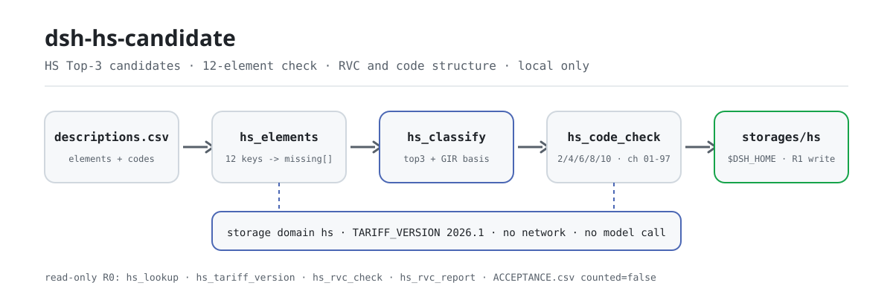
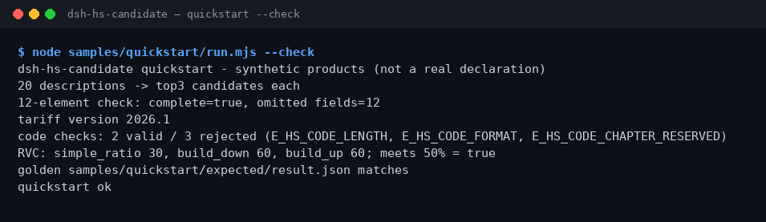

<div align="center">

<picture>
  <source media="(prefers-color-scheme: dark)" srcset="docs/assets/dsh-hs-candidate-flow-dark.svg">
  
</picture>

# dsh-hs-candidate

**Turn a product description into Top-3 HS candidates and list every missing one of the 12 classification elements.**

A local-only HS classification helper for DeepSeek Harness: public-table candidates with a GIR basis, code-structure checks, and three RVC formulas; no network, no model call, and no customs ruling.

[Install](#three-step-setup) · [Configuration](#configuration) · [FAQ](#faq) · [简体中文](README.md) · [English](README.en.md) · [Español](README.es.md) · [Português](README.pt.md) · [हिन्दी](README.hi.md)

[](LICENSE)
[](#compatibility)
[](https://www.npmjs.com/package/dsh-hs-candidate)
[](https://github.com/PerryLink/dsh-hs-candidate/actions/workflows/ci.yml)
[](#compatibility)

[](https://github.com/PerryLink/dsh-hs-candidate/stargazers)
[](https://www.npmjs.com/package/dsh-hs-candidate)
[](https://dshfind.com/plugins/PerryLink/dsh-hs-candidate?ref=badge)
[](https://dsh.market/)
[](https://gitee.com/perrylink/dsh-hs-candidate)

```sh
dsh plugin --profile <profile> add dsh-hs-candidate
```

</div>

<sub>Community plugin, not affiliated with DeepSeek. Canonical repository: <https://github.com/PerryLink/dsh-hs-candidate> (Gitee is a mirror). Status: alpha · public/synthetic validation only · not GA — no customer data or customer evidence, no production-readiness claim.</sub>

## What it is

The first mile of HS classification: turn a one-line product description (material, use, function) into 3 candidate HS codes while checking whether the 12 classification elements are complete. `hs.classify` returns the Top-3 from a public keyword table with a GIR basis and the missing elements, and stores the result with tariff version `2026.1` in the local storage domain; `hs.code_check` validates code structure, and `hs.rvc_report` computes regional value content under simple-ratio, build-down, and build-up formulas. Everything runs on your machine — no network, no model call, no upload, and the input files are never modified. Candidates are leads for human review, not a customs ruling; the project has been actively maintained since 2026-11-01, with new features, hardening, and fresh evidence landing continuously.

- **Good fit**: 20–500 product rows that carry material, use, and function descriptions; getting candidate codes plus an element-gap check before formal classification.
- **Not a fit**: rows with only a product name and no material or use; replacing a customs ruling; generating a customs declaration (this package only gives candidates and structural checks).

## Three-step setup

1. **Install** (pick one channel):

   ```sh
   # npm channel (recommended, published releases)
   dsh plugin --profile <profile> add dsh-hs-candidate
   # git channel (latest main; equivalent to git+https://github.com/PerryLink/dsh-hs-candidate.git)
   dsh plugin --profile <profile> add github:PerryLink/dsh-hs-candidate
   # tarball channel: pnpm pack in this repo, then
   dsh plugin --profile <profile> add ./dsh-hs-candidate-<version>.tgz
   ```

2. **Minimal config** (the install command applies the bundle patch; copy this row when writing a profile by hand):

   ```yaml
   - insert:
       - id: dsh-hs-candidate
         name: dsh-hs-candidate
   ```

   There are no Schemastery config keys; RVC thresholds and the like are passed per tool call — see "Configuration".

3. **Verify it mounts**:

   ```sh
   dsh --profile <profile> --dump-config | grep dsh-hs-candidate
   node samples/quickstart/run.mjs --check
   ```

   The repo ships a synthetic sample; run it once to see the whole chain (it should end with `quickstart ok`). In a session you can also just say:

   > I have 20 product descriptions — give me the top 3 HS candidate codes for each, then check whether the 12 classification elements are complete.

**Uninstall**: `dsh plugin --profile <profile> remove dsh-hs-candidate` (or remove the row from the profile patch).

<details>
<summary>Install from the DSH Desktop market</summary>

Every PerryLink plugin is listed in the built-in DSH Desktop market: **Market → Sources → Add source → paste** `https://perrylink-dsh-catalog.perrylink.workers.dev/catalog-source.json` **→ select**. Installation still requires the market's npm identity check and your confirmation.

</details>

## Core capabilities

- **Top-3 candidates with a GIR basis** — `hs.classify` joins the description with any supplied elements, queries the public keyword table, and returns 3 candidates, each with code, description, confidence, and `gir_basis`; the first uses GIR 1 plus heading text, the rest fall back to GIR 1 and ask you to verify with GIR 3/6.
- **12-element completeness** — `hs.elements` checks `product_name`, `material`, `function`, `use`, `composition`, `processing`, `packaging`, `brand`, `model`, `spec`, `origin`, and `unit`, returning the missing list plus `complete`.
- **Tariff version stamp** — every classification record carries `TARIFF_VERSION=2026.1`; `hs.tariff_version` returns the active version and the 12-element list so results can be archived with the tariff version.
- **Code-structure check** — `hs.code_check` validates 2/4/6/8/10 digits and chapters 01–97; reserved chapters 00/98/99 are rejected with a reason. It checks structure only, never whether the classification is right.
- **Three RVC formulas** — `hs.rvc_report` computes regional value content under simple-ratio, build-down, and build-up; `hs.rvc_check` gives the quick single-ratio number with a threshold verdict.
- **Public-table lookup** — `hs.lookup` matches by code or description inside a public HS table you supply, returning at most 5 rows; read-only, no classification record.
- **Local storage** — `hs.classify` derives a `classification_id` from the description's sha256 and writes each record to the `classifications` table under `$DSH_HOME/storages/hs/`; the original CSV is untouched.

### Tool surface

Tool names are the stable API (kept in English to match the runtime output); descriptions are localized. Tools that write files are **R1 (local write)**; read-only tools are **R0**.

| Tool | Purpose | Risk |
|---|---|---|
| `hs.elements` | Check the 12-element completeness of a product description and return the missing fields | R0 |
| `hs.classify` | Return Top-3 HS candidates from a public table with a GIR basis and element gaps, and store the classification | R1 local write |
| `hs.lookup` | Look up rows by code or description in a supplied public HS table, at most 5 | R0 |
| `hs.tariff_version` | Return the active tariff version (2026.1) and the 12-element list | R0 |
| `hs.rvc_check` | Compute a simple regional-value-content ratio with a threshold verdict | R0 |
| `hs.code_check` | Validate HS code structure (2/4/6/8/10 digits, chapters 01–97) | R0 |
| `hs.rvc_report` | Compute RVC under simple-ratio, build-down, and build-up formulas | R0 |

### Input & output

Input:

- Product description CSV: UTF-8, header `description`; the bundled sample has 20 rows.
- 12-element JSON: keys `product_name`, `material`, `function`, `use`, `composition`, `processing`, `packaging`, `brand`, `model`, `spec`, `origin`, `unit`, values are non-empty text.
- Code list CSV: header `code`, each row handed to `hs.code_check`.
- RVC input JSON: `fob_cents`, `non_originating_cents`, `domestic_value_cents`, optional `labour_overhead_cents` and `threshold_pct`.
- Keep a batch ≤ 1 MB; the bundled sample is about 1 KB.

Output:

- Terminal summary: row count, Top-3 per row, missing-element count, tariff version, code-check results, and the three RVC formulas.
- Classification records: `$DSH_HOME/storages/hs/` (the `classifications` table); original files are never modified.
- Golden file: `samples/quickstart/expected/result.json`, produced by a real run.

### Examples

Copy this prompt verbatim (the demo prompt from `package.json`):

```text
我有 20 条产品描述，帮我给出每条的前 3 个 HS 候选编码，再检查 12 项归类要素齐不齐。
```

Or run it yourself (a real run; the screenshot comes from this command):

```sh
node samples/quickstart/run.mjs --check
```



*20 synthetic descriptions → Top-3 candidates each → 12-element check → tariff version 2026.1 → 5 code checks → 3 RVC formulas; the golden file is `samples/quickstart/expected/result.json`, command and hashes in `screenshots.json`.*

Public fixture acceptance: input [`fixtures/public/mit/hs-sample.json`](https://github.com/PerryLink/dsh-hs-candidate/blob/main/fixtures/public/mit/hs-sample.json) (public MIT sample, 6 rows); re-run `node scripts/acceptance.mjs`, details in `ACCEPTANCE.csv`:

```csv
req_id,metric,threshold,actual,pass,source,counted
SKU-13-A01,Top3 候选（20）,20/20,20,true,public/synthetic,false
SKU-13-A02,缺失要素提示,>=1,12,true,public/synthetic,false
SKU-13-A03,必填要素,12,12,true,public/synthetic,false
SKU-13-A04,税则版本,set,1,true,public/synthetic,false
SKU-13-A05,RVC 简单比值,50,50,true,public/synthetic,false
SKU-13-A06,HS 编码结构,1/1,1,true,public/synthetic,false
SKU-13-A07,RVC 三口径,3,3,true,public/synthetic,false
PS1-QS01,quickstart 样例与金标一致,1/1,1,true,synthetic/quickstart,true
```

*SKU rows are public/synthetic fixture checks (`counted=false`); PS1-QS01 is the bundled-sample replay (`counted=true`). Neither is a customer run, and no output is invented; the full columns (incl. `script` and `evidence_sha256`) are in [`ACCEPTANCE.csv`](ACCEPTANCE.csv).*

## Configuration

This plugin has no Schemastery `Config` keys — `cordis.patch.yml` only `insert`s one row (see "Three-step setup"), and classification records go to `$DSH_HOME/storages/hs/`. Everything adjustable is a per-call tool parameter:

| Parameter | Default | Meaning |
|---|---|---|
| `threshold_pct` (`hs.rvc_check`) | `40` | RVC threshold in percent; `rvc_pct >= threshold_pct` yields `qualifies: true` |
| `threshold_pct` (`hs.rvc_report`) | none | Optional; when omitted the three formulas are reported and `meets_threshold` is always `true` |
| `labour_overhead_cents` (`hs.rvc_report`) | `0` | Labour and overhead counted in the build-up formula |
| `elements` (`hs.elements` / `hs.classify`) | none | The 12-element object; missing or empty keys count as missing, so a description alone leaves all 12 missing |
| `hs_table` (`hs.lookup`) | none | The public table rows you supply; lookup matches only inside this table, at most 5 rows |

## FAQ

<details>
<summary>Install fails — what now?</summary>

Check that DSH is `>=0.2.1-rc.3 <0.4.0` and Node `>=24.9 <25` (see "Compatibility"), then retry `dsh plugin --profile <profile> add dsh-hs-candidate`; if it still fails, open an issue with the package version, a minimal synthetic input, and the full error.

</details>

<details>
<summary>The candidate codes look wrong — what should I check?</summary>

First run `node samples/quickstart/run.mjs --check` to confirm the chain works, then check whether the description states material, use, and function. Candidates are ranked by a built-in public keyword table, not a customs ruling; the final code needs human review, and structural mistakes can be ruled out with `hs.code_check` first.

</details>

<details>
<summary>Where is the data stored? Will my product table be changed?</summary>

No input file is modified. Classification records are written only to the local storage domain `$DSH_HOME/storages/hs/` (the `classifications` table); input CSV/JSON is read by the session and passed to the tools as parameters, with no upload and no network.

</details>

<details>
<summary>Can I use real customs data?</summary>

It runs locally, but this package is alpha and validated only on public/synthetic data, so it is not a classification or customs conclusion; sanitize real data and keep a reviewer. Do not paste real customs declarations into issues.

</details>

<details>
<summary>Does it call the network or a model?</summary>

No. Tools, samples, and acceptance all run locally; the source contains no HTTP / DNS / WebSocket calls.

</details>

## Security boundaries

- **No network, no model call.** Unless a tool explicitly says otherwise, there is no model or network call; input and output stay local.
- **Original files are never modified.** Writes land only in `$DSH_HOME/storages/hs/` (the `classifications` table); input CSV/JSON is read-only.
- **Candidates and structure checks only, never a ruling.** `hs.classify` only queries the public keyword table and gives a GIR basis; `hs.code_check` only validates digit count and chapter range. The final code always needs human review.
- **Uniform, loud errors.** Every error is one plain sentence plus the `E_XXX` code plus one next action; the symptoms / causes / actions for the three common ones (empty description `E_HS_DESCRIPTION_MISSING`, wrong code length or characters, reserved chapter) are in [TROUBLESHOOTING.md](TROUBLESHOOTING.md).
- **Risk grading.** `hs.classify` writes files and is graded R1 (local write); all other tools are R0 (read-only) — see the tool table under "Core capabilities".

## Permissions & data

- **Read**: the product description CSV, 12-element JSON, code list CSV, and RVC input JSON you specify; no other directories.
- **Write**: `$DSH_HOME/storages/hs/` (classification records); original files untouched.
- **Network**: none (no HTTP / DNS / WebSocket calls in the source).
- **External systems**: none (no customs, ERP, or tariff service is contacted).
- **Data boundary**: public/synthetic samples only; no customer data or customer evidence.

## Known limitations

- **Public/synthetic validation only.** Every acceptance row comes from a public or synthetic fixture (`counted=false` for SKU rows, `counted=true` for the PS1-QS01 sample replay); no customer data or customer evidence.
- **alpha / partial / not counted / not GA.** No production-readiness claim; not a classification or customs conclusion.
- **Candidates come from a small public keyword table.** It has only 5 real entries (plastics, iron/steel, motors, cotton trousers, portable computers), and when fewer than 3 match the list is padded in fixed order; confidence is just a ranking hint (0.9 / 0.75 / 0.6), not a probability.
- **Tariff version is fixed at 2026.1.** The tools neither download nor hot-update tariff tables; upgrade the plugin when the version changes.
- **Structural validity is not correct classification.** `hs.code_check` only validates 2/4/6/8/10 digits and chapters 01–97, rejecting reserved chapters 00/98/99; it tells you whether the code looks well-formed, not whether it belongs here.
- **Input format constraints.** CSV must be UTF-8 with an exact header; keep a batch ≤ 1 MB.
- **Exact per-tool boundaries** are in the tool table under "Core capabilities" and in `ACCEPTANCE.csv`.

## Compatibility

| Dimension | Status |
|---|---|
| Harness | DeepSeek Harness `>=0.2.1-rc.3 <0.4.0` (`engines.dsh` in `package.json`) |
| Node | `>=24.9.0 <25` (`.nvmrc`: 24) |
| Platform | Anywhere DSH runs; local files only |
| Data | No network, no model call, no upload |

## Ecosystem & quality

- [Gitee mirror](https://gitee.com/perrylink/dsh-hs-candidate) (synced mirror; GitHub is canonical)
- [dshfind plugin page](https://dshfind.com/plugins/PerryLink/dsh-hs-candidate) (installs and rank)
- [DSH Market](https://dsh.market/) (listed)
- **1024 store channel**: run `npm i -g dsh1024`, then `dsh1024 plugin --profile <profile> add dsh-hs-candidate` (counts toward the [deepseek1024.com](https://deepseek1024.com) install ranking)
- Docs: [`TROUBLESHOOTING.md`](TROUBLESHOOTING.md) (troubleshooting) · [`PRIVACY.md`](PRIVACY.md) · [`SECURITY.md`](SECURITY.md) · [`EVIDENCE.md`](EVIDENCE.md) · [domain index](https://perrylink.github.io/dsh-plugins/) · [Checker family](https://perrylink.github.io/zh/checkers/) · [mainline family](https://github.com/PerryLink/dsh-kit)

### Related projects & checkers

Sibling packages and family indexes: [dsh-freight-audit](https://github.com/PerryLink/dsh-freight-audit) · [dsh-pim-lint](https://github.com/PerryLink/dsh-pim-lint)

Each checker is a separate package with its own rule pack and version; install only the ones you need:

| Package | Why it is relevant |
|---|---|
| [`dsh-hs-classify`](https://github.com/PerryLink/dsh-hs-classify) | HS hierarchy consistency for a declared classification |
| [`dsh-origin-rvc-check`](https://github.com/PerryLink/dsh-origin-rvc-check) | Regional value content and origin determination |
| [`dsh-customs-doc-check`](https://github.com/PerryLink/dsh-customs-doc-check) | Customs declaration document consistency |

## Development

```sh
pnpm install --frozen-lockfile                              # node >=24.9 <25
pnpm build && pnpm lint && pnpm typecheck && pnpm test      # tsc build + lint + 13 node --test cases
pnpm gate:sku13                                             # SKU-13 acceptance gate (ACCEPTANCE.csv)
node scripts/acceptance.mjs                                 # re-run public/synthetic acceptance
node samples/quickstart/run.mjs --check                     # sample replay against the golden file; should print quickstart ok
pnpm run pack:check                                         # publish-content dry run (writes pack.json)
```

Current version `0.1.1` (matches `package.json`). Tests: `node --test test/*.test.mjs` is green (7 test files, 13 cases; `pnpm test` already runs the build). TypeScript sources live in `src/` (`src/core/` holds classification, code, and RVC logic; `src/plugin/` the host face and storage domain), build output in `lib/`; fixtures are in `fixtures/public/mit/`, the bundled sample in `samples/quickstart/`, and acceptance records in `evidence/`. The opening diagram is generated by [`scripts/gen-readme-assets.py`](scripts/gen-readme-assets.py) (Python; light/dark SVG pair shared by all five languages) and can be re-run with `python scripts/gen-readme-assets.py`.

Topics: `deepseek-harness`, `dsh`, `dsh-plugin`, `hs`, `customs`, `tariff`, `perrylink`, `trade`

## Family & acknowledgements

This project is a member of the DeepSeek Harness plugin family maintained by [PerryLink](https://github.com/PerryLink) (all Apache-2.0). If this plugin helps you, **give it a star** — it unlocks nothing, but it makes the next person find it more easily.

- [@PerryLink](https://github.com/PerryLink) — creator and maintainer: the HS candidate engine, 12-element check, code-structure validation, three-formula RVC, quickstart sample and acceptance suite, and five-language docs.

## License

[LICENSE](LICENSE) (Apache License 2.0) © 2026 dsh-hs-candidate contributors; see also `NOTICE` and `THIRD-PARTY-NOTICES`.

<p align="center"><sub>Apache-2.0 · Community plugin, not affiliated with DeepSeek.</sub></p>
