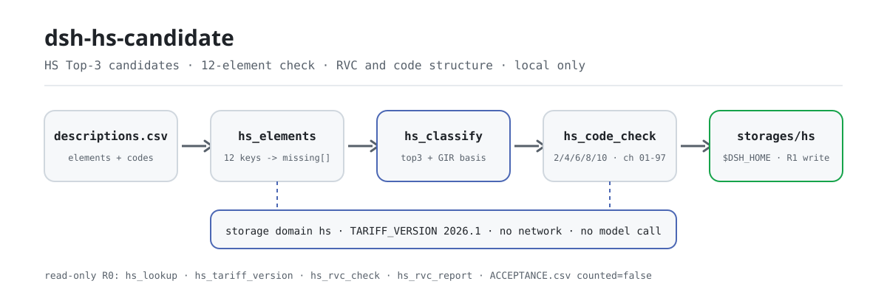
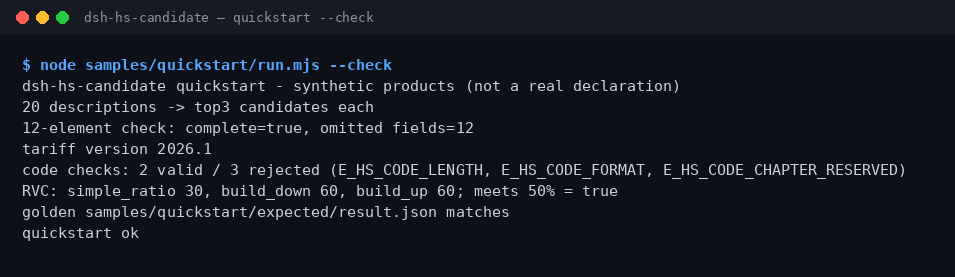

<div align="center">

<picture>
  <source media="(prefers-color-scheme: dark)" srcset="docs/assets/dsh-hs-candidate-flow-dark.svg">
  
</picture>

# dsh-hs-candidate

**Convierte una descripción de producto en los 3 candidatos HS principales y enumera de una vez todos los elementos de clasificación que faltan de los 12.**

Un asistente de clasificación HS puramente local para DeepSeek Harness: candidatos de tabla pública con base GIR, validación de la estructura de códigos y RVC con tres fórmulas; sin red, sin llamada a modelo y sin arrogarse una resolución aduanera.

[Instalación](#instalación-en-tres-pasos) · [Configuración](#configuración) · [FAQ](#faq) · [简体中文](README.md) · [English](README.en.md) · [Español](README.es.md) · [Português](README.pt.md) · [हिन्दी](README.hi.md)

[](LICENSE)
[](#compatibilidad)
[](https://www.npmjs.com/package/dsh-hs-candidate)
[](https://github.com/PerryLink/dsh-hs-candidate/actions/workflows/ci.yml)
[](#compatibilidad)

[](https://github.com/PerryLink/dsh-hs-candidate/stargazers)
[](https://www.npmjs.com/package/dsh-hs-candidate)
[](https://dshfind.com/plugins/PerryLink/dsh-hs-candidate?ref=badge)
[](https://dsh.market/)
[](https://gitee.com/perrylink/dsh-hs-candidate)

```sh
dsh plugin --profile <profile> add dsh-hs-candidate
```

</div>

<sub>Plugin de la comunidad, no afiliado a DeepSeek. Repositorio canónico: <https://github.com/PerryLink/dsh-hs-candidate> (Gitee es un espejo). Estado: alpha · solo validación pública/sintética · no GA: sin datos ni evidencia de clientes, sin promesa de producción.</sub>

## Qué es

El primer tramo de la clasificación HS: convierte una descripción de producto (material, uso, función) en 3 códigos HS candidatos y, a la vez, comprueba si los 12 elementos de clasificación están completos. `hs.classify` devuelve el Top-3 desde una tabla pública de palabras clave con base GIR y los elementos faltantes, y guarda el resultado con la versión arancelaria `2026.1` en el dominio de almacenamiento local; `hs.code_check` valida la estructura del código y `hs.rvc_report` calcula el contenido regional con las fórmulas de ratio simple, build-down y build-up. Todo se ejecuta en tu máquina: sin red, sin llamada a modelo, sin subidas, y los archivos de entrada nunca se modifican. Los candidatos son pistas para revisión humana, no una resolución aduanera; el proyecto se mantiene activo desde el 2026-11-01, con nuevas funciones, endurecimiento y evidencia continua.

- **Encaja**: listas de 20–500 productos con material, uso y función descritos; obtener códigos candidatos y un chequeo de elementos antes de la clasificación formal.
- **No encaja**: filas con solo el nombre y sin material ni uso; sustituir una resolución aduanera; generar una declaración de aduanas (este paquete solo da candidatos y comprobaciones estructurales).

## Instalación en tres pasos

1. **Instala** (elige un canal):

   ```sh
   # canal npm (recomendado, versiones publicadas)
   dsh plugin --profile <profile> add dsh-hs-candidate
   # canal git (último main; equivale a git+https://github.com/PerryLink/dsh-hs-candidate.git)
   dsh plugin --profile <profile> add github:PerryLink/dsh-hs-candidate
   # canal tarball: pnpm pack en este repo y luego
   dsh plugin --profile <profile> add ./dsh-hs-candidate-<version>.tgz
   ```

2. **Configuración mínima** (el comando de instalación ya aplica el patch del bundle; copia esta fila si escribes el perfil a mano):

   ```yaml
   - insert:
       - id: dsh-hs-candidate
         name: dsh-hs-candidate
   ```

   No hay claves de configuración de Schemastery; los umbrales de RVC y demás se pasan en cada llamada a la herramienta — ver «Configuración».

3. **Verifica que se monta**:

   ```sh
   dsh --profile <profile> --dump-config | grep dsh-hs-candidate
   node samples/quickstart/run.mjs --check
   ```

   El repo incluye una muestra sintética; ejecútala una vez para ver toda la cadena (debe terminar con `quickstart ok`). En una sesión también puedes decir:

   > Tengo 20 descripciones de producto; dame los 3 códigos HS candidatos de cada una y comprueba si los 12 elementos de clasificación están completos.

**Desinstalar**: `dsh plugin --profile <profile> remove dsh-hs-candidate` (o borra la fila del patch del perfil).

<details>
<summary>Instalar desde el mercado de DSH Desktop</summary>

Todos los plugins de PerryLink aparecen en el mercado integrado de DSH Desktop: **Mercado → Fuentes → Añadir fuente → pegar** `https://perrylink-dsh-catalog.perrylink.workers.dev/catalog-source.json` **→ seleccionar**. La instalación sigue requiriendo la comprobación de identidad npm del mercado y tu confirmación.

</details>

## Capacidades principales

- **Candidatos Top-3 con base GIR** — `hs.classify` une la descripción con los elementos disponibles, consulta la tabla pública de palabras clave y devuelve 3 candidatos, cada uno con código, descripción, confianza y `gir_basis`; el primero usa GIR 1 más el texto de la partida, y el resto recurre a GIR 1 e indica verificar con GIR 3/6.
- **Completitud de los 12 elementos** — `hs.elements` comprueba `product_name`, `material`, `function`, `use`, `composition`, `processing`, `packaging`, `brand`, `model`, `spec`, `origin` y `unit`, y devuelve la lista de faltantes más `complete`.
- **Sello de versión arancelaria** — cada registro de clasificación lleva `TARIFF_VERSION=2026.1`; `hs.tariff_version` devuelve la versión activa y la lista de 12 elementos para archivar el resultado junto a su versión.
- **Comprobación de estructura del código** — `hs.code_check` valida 2/4/6/8/10 dígitos y los capítulos 01–97; los capítulos reservados 00/98/99 se rechazan con un motivo. Solo comprueba la estructura, nunca si la clasificación es correcta.
- **Tres fórmulas de RVC** — `hs.rvc_report` calcula el contenido regional con ratio simple, build-down y build-up; `hs.rvc_check` da el número rápido de un solo ratio con veredicto de umbral.
- **Consulta en tabla pública** — `hs.lookup` busca por código o descripción dentro de una tabla HS pública que tú aportas y devuelve como máximo 5 filas; es de solo lectura y no escribe registros.
- **Almacenamiento local** — `hs.classify` deriva un `classification_id` del sha256 de la descripción y escribe cada registro en la tabla `classifications` de `$DSH_HOME/storages/hs/`; el CSV original no se toca.

### Superficie de herramientas

Los nombres de herramienta son la API estable (se mantienen en inglés para coincidir con la salida del runtime); las descripciones están localizadas. Las herramientas que escriben archivos son **R1 (escritura local)**; las de solo lectura son **R0**.

| Herramienta | Propósito | Riesgo |
|---|---|---|
| `hs.elements` | Comprueba la completitud de los 12 elementos de una descripción y devuelve los campos que faltan | R0 |
| `hs.classify` | Devuelve el Top-3 de candidatos HS desde una tabla pública con base GIR y huecos de elementos, y guarda la clasificación | R1 escritura local |
| `hs.lookup` | Busca filas por código o descripción en una tabla HS pública aportada, máximo 5 | R0 |
| `hs.tariff_version` | Devuelve la versión arancelaria activa (2026.1) y la lista de 12 elementos | R0 |
| `hs.rvc_check` | Calcula un ratio simple de contenido regional con veredicto de umbral | R0 |
| `hs.code_check` | Valida la estructura del código HS (2/4/6/8/10 dígitos, capítulos 01–97) | R0 |
| `hs.rvc_report` | Calcula el RVC con las fórmulas de ratio simple, build-down y build-up | R0 |

### Entrada y salida

Entrada:

- CSV de descripciones: UTF-8, cabecera `description`; la muestra incluida tiene 20 filas.
- JSON de 12 elementos: claves `product_name`, `material`, `function`, `use`, `composition`, `processing`, `packaging`, `brand`, `model`, `spec`, `origin`, `unit`, con texto no vacío.
- CSV de códigos: cabecera `code`, cada fila pasa a `hs.code_check`.
- JSON de entrada RVC: `fob_cents`, `non_originating_cents`, `domestic_value_cents`, y opcionales `labour_overhead_cents` y `threshold_pct`.
- Mantén el lote ≤ 1 MB; la muestra incluida ronda 1 KB.

Salida:

- Resumen en terminal: número de filas, Top-3 por fila, elementos faltantes, versión arancelaria, resultados de los códigos y las tres fórmulas de RVC.
- Registros de clasificación: `$DSH_HOME/storages/hs/` (tabla `classifications`); los archivos originales no se modifican.
- Archivo dorado: `samples/quickstart/expected/result.json`, producido por una ejecución real.

### Ejemplos

Copia este prompt tal cual (el prompt de demostración de `package.json`):

```text
我有 20 条产品描述，帮我给出每条的前 3 个 HS 候选编码，再检查 12 项归类要素齐不齐。
```

O ejecútalo tú mismo (ejecución real; la captura viene de este comando):

```sh
node samples/quickstart/run.mjs --check
```



*20 descripciones sintéticas → Top-3 por descripción → comprobación de 12 elementos → versión arancelaria 2026.1 → 5 comprobaciones de código → RVC con 3 fórmulas; el archivo dorado es `samples/quickstart/expected/result.json`, comando y hashes en `screenshots.json`.*

Aceptación con fixture público: entrada [`fixtures/public/mit/hs-sample.json`](https://github.com/PerryLink/dsh-hs-candidate/blob/main/fixtures/public/mit/hs-sample.json) (muestra pública MIT, 6 filas); vuelve a ejecutar `node scripts/acceptance.mjs`, detalles en `ACCEPTANCE.csv`:

```csv
req_id,metric,threshold,actual,pass,source,counted
SKU-13-A01,Top3 候选（20）,20/20,20,true,public/synthetic,false
SKU-13-A02,缺失要素提示,>=1,12,true,public/synthetic,false
SKU-13-A03,必填要素,12,12,true,public/synthetic,false
SKU-13-A04,税则版本,set,1,true,public/synthetic,false
SKU-13-A05,RVC 简单比值,50,50,true,public/synthetic,false
SKU-13-A06,HS 编码结构,1/1,1,true,public/synthetic,false
SKU-13-A07,RVC 三口径,3,3,true,public/synthetic,false
PS1-QS01,quickstart 样例与金标一致,1/1,1,true,synthetic/quickstart,true
```

*Las filas SKU son comprobaciones con fixture público/sintético (`counted=false`); PS1-QS01 es la repetición de la muestra incluida (`counted=true`). Ninguna es una ejecución de cliente y no se inventa ninguna salida; las columnas completas (incl. `script` y `evidence_sha256`) están en [`ACCEPTANCE.csv`](ACCEPTANCE.csv).*

## Configuración

Este plugin no tiene claves `Config` de Schemastery: `cordis.patch.yml` solo `insert`a una fila (ver «Instalación en tres pasos») y los registros de clasificación van a `$DSH_HOME/storages/hs/`. Todo lo ajustable es un parámetro por llamada:

| Parámetro | Valor por defecto | Significado |
|---|---|---|
| `threshold_pct` (`hs.rvc_check`) | `40` | Umbral de RVC en porcentaje; `rvc_pct >= threshold_pct` da `qualifies: true` |
| `threshold_pct` (`hs.rvc_report`) | ninguno | Opcional; si se omite se informan las tres fórmulas y `meets_threshold` siempre es `true` |
| `labour_overhead_cents` (`hs.rvc_report`) | `0` | Mano de obra y gastos generales contados en la fórmula build-up |
| `elements` (`hs.elements` / `hs.classify`) | ninguno | Objeto de 12 elementos; las claves ausentes o vacías cuentan como faltantes, así que solo con la descripción faltan las 12 |
| `hs_table` (`hs.lookup`) | ninguno | Las filas de tabla pública que aportas; la consulta solo busca en esa tabla, máximo 5 filas |

## FAQ

<details>
<summary>No se instala, ¿y ahora qué?</summary>

Comprueba que DSH sea `>=0.2.1-rc.3 <0.4.0` y Node `>=24.9 <25` (ver «Compatibilidad») y reintenta `dsh plugin --profile <profile> add dsh-hs-candidate`; si sigue fallando, abre un issue con la versión del paquete, una entrada sintética mínima y el error completo.

</details>

<details>
<summary>Los códigos candidatos no parecen correctos, ¿qué reviso?</summary>

Primero ejecuta `node samples/quickstart/run.mjs --check` para confirmar que la cadena funciona y luego revisa si la descripción indica material, uso y función. Los candidatos se ordenan con una tabla pública de palabras clave, no con una resolución aduanera; el código final necesita revisión humana, y los errores estructurales se descartan antes con `hs.code_check`.

</details>

<details>
<summary>¿Dónde se guardan los datos? ¿Se modifica mi tabla de productos?</summary>

Ningún archivo de entrada se modifica. Los registros de clasificación solo se escriben en el dominio de almacenamiento local `$DSH_HOME/storages/hs/` (tabla `classifications`); la sesión lee el CSV/JSON de entrada y lo pasa a las herramientas como parámetros, sin subidas ni red.

</details>

<details>
<summary>¿Puedo usar datos reales de aduana?</summary>

Se ejecuta localmente, pero este paquete es alpha y solo está validado con datos públicos/sintéticos, así que no constituye una conclusión de clasificación ni de aduana; anonimiza los datos reales y conserva un revisor. No pegues declaraciones de aduana reales en los issues.

</details>

<details>
<summary>¿Llama a la red o a un modelo?</summary>

No. Herramientas, muestras y aceptación se ejecutan en local; el código fuente no contiene llamadas HTTP / DNS / WebSocket.

</details>

## Límites de seguridad

- **Sin red y sin llamada a modelo.** Salvo que una herramienta lo diga explícitamente, no hay llamada a modelo ni a red; la entrada y la salida se quedan en local.
- **Los archivos originales no se modifican.** Las escrituras solo van a `$DSH_HOME/storages/hs/` (tabla `classifications`); el CSV/JSON de entrada es de solo lectura.
- **Solo candidatos y comprobaciones estructurales, nunca una resolución.** `hs.classify` solo consulta la tabla pública de palabras clave y da una base GIR; `hs.code_check` solo valida el número de dígitos y el rango de capítulos. El código final siempre requiere revisión humana.
- **Errores uniformes y ruidosos.** Cada error es una frase llana más el código `E_XXX` más una acción siguiente; los síntomas / causas / acciones de los tres habituales (descripción vacía `E_HS_DESCRIPTION_MISSING`, longitud o caracteres del código incorrectos, capítulo reservado) están en [TROUBLESHOOTING.md](TROUBLESHOOTING.md).
- **Graduación de riesgo.** `hs.classify` escribe archivos y se clasifica R1 (escritura local); el resto son R0 (solo lectura) — ver la tabla de herramientas en «Capacidades principales».

## Permisos y datos

- **Lectura**: el CSV de descripciones, el JSON de 12 elementos, el CSV de códigos y el JSON de RVC que indiques; ningún otro directorio.
- **Escritura**: `$DSH_HOME/storages/hs/` (registros de clasificación); los archivos originales no se tocan.
- **Red**: no (sin llamadas HTTP / DNS / WebSocket en el código).
- **Sistemas externos**: ninguno (no se contacta con aduanas, ERP ni servicios arancelarios).
- **Límite de datos**: solo muestras públicas/sintéticas; sin datos ni evidencia de clientes.

## Limitaciones conocidas

- **Solo validación pública/sintética.** Todas las filas de aceptación vienen de un fixture público o sintético (`counted=false` en las filas SKU, `counted=true` en la repetición PS1-QS01); sin datos ni evidencia de clientes.
- **alpha / parcial / no contabilizado / no GA.** Sin promesa de producción; no es una conclusión de clasificación ni de aduana.
- **Los candidatos vienen de una tabla pública pequeña.** Solo tiene 5 entradas reales (plásticos, hierro/acero, motores, pantalones de algodón, ordenadores portátiles) y, si coinciden menos de 3, la lista se completa en orden fijo; la confianza es solo una pista de orden (0.9 / 0.75 / 0.6), no una probabilidad.
- **La versión arancelaria está fija en 2026.1.** Las herramientas no descargan ni actualizan en caliente las tablas arancelarias; actualiza el plugin cuando cambie la versión.
- **La estructura válida no es una clasificación correcta.** `hs.code_check` solo valida 2/4/6/8/10 dígitos y los capítulos 01–97, y rechaza los reservados 00/98/99; te dice si el código tiene forma correcta, no si pertenece ahí.
- **Restricciones de formato de entrada.** CSV en UTF-8 con cabecera exacta; mantén el lote ≤ 1 MB.
- **Los límites exactos de cada herramienta** están en la tabla de «Capacidades principales» y en `ACCEPTANCE.csv`.

## Compatibilidad

| Dimensión | Estado |
|---|---|
| Harness | DeepSeek Harness `>=0.2.1-rc.3 <0.4.0` (`engines.dsh` en `package.json`) |
| Node | `>=24.9.0 <25` (`.nvmrc`: 24) |
| Plataforma | Donde corra DSH; solo archivos locales |
| Datos | Sin red, sin llamada a modelo, sin subidas |

## Ecosistema y calidad

- [Espejo en Gitee](https://gitee.com/perrylink/dsh-hs-candidate) (espejo sincronizado; GitHub es el canónico)
- [Página de dshfind](https://dshfind.com/plugins/PerryLink/dsh-hs-candidate) (instalaciones y ranking)
- [DSH Market](https://dsh.market/) (publicado)
- **Canal de la tienda 1024**: ejecuta `npm i -g dsh1024` y luego `dsh1024 plugin --profile <profile> add dsh-hs-candidate` (cuenta para el ranking de instalaciones de [deepseek1024.com](https://deepseek1024.com))
- Documentación: [`TROUBLESHOOTING.md`](TROUBLESHOOTING.md) (resolución de problemas) · [`PRIVACY.md`](PRIVACY.md) · [`SECURITY.md`](SECURITY.md) · [`EVIDENCE.md`](EVIDENCE.md) · [índice de dominio](https://perrylink.github.io/dsh-plugins/) · [familia Checker](https://perrylink.github.io/zh/checkers/) · [familia principal](https://github.com/PerryLink/dsh-kit)

### Proyectos y verificadores relacionados

Paquetes hermanos e índices de familia: [dsh-freight-audit](https://github.com/PerryLink/dsh-freight-audit) · [dsh-pim-lint](https://github.com/PerryLink/dsh-pim-lint)

Cada verificador es un paquete aparte con su propio paquete de reglas y versión; instala solo los que necesites:

| Paquete | Por qué es relevante |
|---|---|
| [`dsh-hs-classify`](https://github.com/PerryLink/dsh-hs-classify) | Consistencia jerárquica HS para una clasificación declarada |
| [`dsh-origin-rvc-check`](https://github.com/PerryLink/dsh-origin-rvc-check) | Contenido regional y determinación de origen |
| [`dsh-customs-doc-check`](https://github.com/PerryLink/dsh-customs-doc-check) | Consistencia de documentos de declaración aduanera |

## Desarrollo

```sh
pnpm install --frozen-lockfile                              # node >=24.9 <25
pnpm build && pnpm lint && pnpm typecheck && pnpm test      # build tsc + lint + 13 casos node --test
pnpm gate:sku13                                             # puerta de aceptación SKU-13 (ACCEPTANCE.csv)
node scripts/acceptance.mjs                                 # repetir la aceptación pública/sintética
node samples/quickstart/run.mjs --check                     # muestra contra el archivo dorado; debe imprimir quickstart ok
pnpm run pack:check                                         # dry-run del contenido publicado (escribe pack.json)
```

Versión actual `0.1.1` (coincide con `package.json`). Pruebas: `node --test test/*.test.mjs` en verde (7 archivos de test, 13 casos; `pnpm test` ya incluye el build). El código TypeScript está en `src/` (`src/core/` contiene la lógica de clasificación, códigos y RVC; `src/plugin/` la cara host y el dominio de almacenamiento), la salida de compilación en `lib/`; los fixtures en `fixtures/public/mit/`, la muestra incluida en `samples/quickstart/` y los registros de aceptación en `evidence/`. El diagrama de apertura lo genera [`scripts/gen-readme-assets.py`](scripts/gen-readme-assets.py) (Python; par SVG claro/oscuro compartido por los cinco idiomas) y se puede repetir con `python scripts/gen-readme-assets.py`.

Temas: `deepseek-harness`, `dsh`, `dsh-plugin`, `hs`, `customs`, `tariff`, `perrylink`, `trade`

## Familia y agradecimientos

Este proyecto es miembro de la familia de plugins de DeepSeek Harness mantenida por [PerryLink](https://github.com/PerryLink) (todos Apache-2.0). Si este plugin te ayuda, **dale una estrella**: no desbloquea nada, pero hace que la siguiente persona lo encuentre más fácil.

- [@PerryLink](https://github.com/PerryLink) — creador y mantenedor: motor de candidatos HS, comprobación de 12 elementos, validación de estructura de códigos, RVC de tres fórmulas, muestra quickstart y suite de aceptación, y documentación en cinco idiomas.

## Licencia

[LICENSE](LICENSE) (Apache License 2.0) © 2026 dsh-hs-candidate contributors; ver también `NOTICE` y `THIRD-PARTY-NOTICES`.

<p align="center"><sub>Apache-2.0 · Plugin de la comunidad, no afiliado a DeepSeek.</sub></p>
