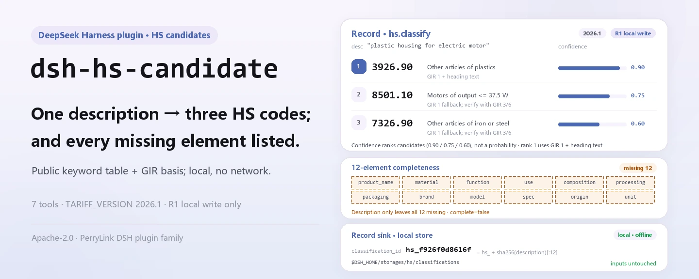
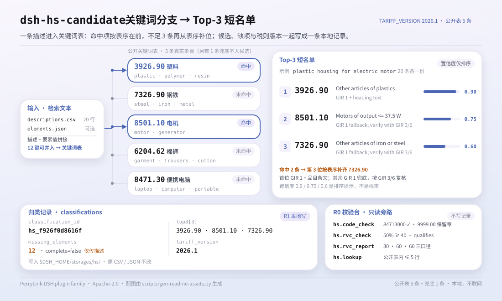
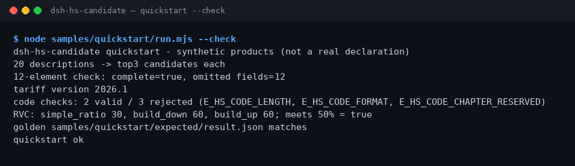

<div align="center">

<picture>
  <source media="(prefers-color-scheme: dark)" srcset="docs/assets/dsh-hs-candidate-hero-en-dark.webp">
  
</picture>

# dsh-hs-candidate

**उत्पाद विवरण को टॉप-3 HS उम्मीदवार कोड में बदलें और 12 वर्गीकरण तत्वों में जो भी छूटा है उसे एक बार में सूचीबद्ध करें।**

DeepSeek Harness के लिए शुद्ध स्थानीय HS वर्गीकरण सहायक: सार्वजनिक तालिका से GIR आधार सहित उम्मीदवार, कोड संरचना की जाँच और तीन सूत्रों वाला RVC; कोई नेटवर्क नहीं, कोई मॉडल कॉल नहीं, और सीमा शुल्क निर्णय का दावा नहीं।

[इंस्टॉल](#तीन-चरणों-में-शुरुआत) · [कॉन्फ़िगरेशन](#कॉन्फ़िगरेशन) · [FAQ](#faq) · [简体中文](README.md) · [English](README.en.md) · [Español](README.es.md) · [Português](README.pt.md) · [हिन्दी](README.hi.md)

[](LICENSE)
[](#संगतता)
[](https://www.npmjs.com/package/dsh-hs-candidate)
[](https://github.com/PerryLink/dsh-hs-candidate/actions/workflows/ci.yml)
[](#संगतता)

[](https://github.com/PerryLink/dsh-hs-candidate/stargazers)
[](https://www.npmjs.com/package/dsh-hs-candidate)
[](https://dshfind.com/plugins/PerryLink/dsh-hs-candidate?ref=badge)
[](https://dsh.market/)
[](https://gitee.com/perrylink/dsh-hs-candidate)

```sh
dsh plugin --profile <profile> add dsh-hs-candidate
```

</div>

<sub>सामुदायिक प्लगइन, DeepSeek से असंबद्ध। कैनोनिकल रिपॉज़िटरी: <https://github.com/PerryLink/dsh-hs-candidate> (Gitee एक मिरर है)। स्थिति: alpha · केवल सार्वजनिक/सिंथेटिक सत्यापन · GA नहीं — ग्राहक डेटा या साक्ष्य नहीं, उत्पादन-तैयारी का दावा नहीं।</sub>

## यह क्या है

HS वर्गीकरण की पहली कड़ी: एक पंक्ति के उत्पाद विवरण (सामग्री, उपयोग, कार्य) को 3 संभावित HS कोड में बदलना और साथ ही यह जाँचना कि 12 वर्गीकरण तत्व भरे हैं या नहीं। `hs.classify` सार्वजनिक कीवर्ड तालिका से GIR आधार और छूटे तत्वों सहित टॉप-3 देता है और परिणाम को टैरिफ़ संस्करण `2026.1` के साथ स्थानीय स्टोरेज डोमेन में लिखता है; `hs.code_check` कोड की संरचना जाँचता है और `hs.rvc_report` सरल अनुपात, build-down और build-up सूत्रों से क्षेत्रीय मूल्य सामग्री निकालता है। सारी गणना आपकी मशीन पर होती है — कोई नेटवर्क नहीं, कोई मॉडल कॉल नहीं, कोई अपलोड नहीं, और इनपुट फ़ाइलें कभी नहीं बदलतीं। उम्मीदवार मानव समीक्षा के संकेत हैं, सीमा शुल्क निर्णय नहीं; परियोजना 2026-11-01 से सक्रिय है और नई सुविधाएँ, सख़्ती व नया साक्ष्य लगातार जुड़ रहे हैं।

- **किसके लिए ठीक है**: 20–500 उत्पाद पंक्तियाँ जिनमें सामग्री, उपयोग और कार्य लिखे हों; औपचारिक वर्गीकरण से पहले उम्मीदवार कोड और तत्वों की कमी की जाँच।
- **किसके लिए नहीं**: सिर्फ़ नाम वाली पंक्तियाँ जिनमें सामग्री और उपयोग न हो; सीमा शुल्क निर्णय की जगह लेना; सीमा शुल्क घोषणा बनाना (यह पैकेज केवल उम्मीदवार और संरचना जाँच देता है)।

<picture>
  <source media="(prefers-color-scheme: dark)" srcset="docs/assets/dsh-hs-candidate-flow-v5-dark.svg">
  
</picture>

## तीन चरणों में शुरुआत

1. **इंस्टॉल करें** (एक चैनल चुनें):

   ```sh
   # npm चैनल (अनुशंसित, प्रकाशित संस्करण)
   dsh plugin --profile <profile> add dsh-hs-candidate
   # git चैनल (नवीनतम main; git+https://github.com/PerryLink/dsh-hs-candidate.git के बराबर)
   dsh plugin --profile <profile> add github:PerryLink/dsh-hs-candidate
   # tarball चैनल: इस रेपो में pnpm pack करके
   dsh plugin --profile <profile> add ./dsh-hs-candidate-<version>.tgz
   ```

2. **न्यूनतम कॉन्फ़िग** (इंस्टॉल कमांड बंडल पैच लगा देता है; प्रोफ़ाइल हाथ से लिखें तो यही पंक्ति कॉपी करें):

   ```yaml
   - insert:
       - id: dsh-hs-candidate
         name: dsh-hs-candidate
   ```

   Schemastery कॉन्फ़िग कुंजियाँ नहीं हैं; RVC सीमाएँ आदि हर टूल कॉल में पैरामीटर के रूप में दी जाती हैं — देखें «कॉन्फ़िगरेशन»।

3. **जाँचें कि माउंट हुआ**:

   ```sh
   dsh --profile <profile> --dump-config | grep dsh-hs-candidate
   node samples/quickstart/run.mjs --check
   ```

   रेपो में सिंथेटिक नमूना है; पूरी श्रृंखला देखने के लिए एक बार चलाएँ (अंत में `quickstart ok` आना चाहिए)। सेशन में सीधे यह भी कह सकते हैं:

   > मेरे पास 20 उत्पाद विवरण हैं; हर एक के लिए 3 HS उम्मीदवार कोड दें और जाँचें कि 12 वर्गीकरण तत्व पूरे हैं या नहीं।

**अनइंस्टॉल**: `dsh plugin --profile <profile> remove dsh-hs-candidate` (या प्रोफ़ाइल पैच से पंक्ति हटा दें)।

<details>
<summary>DSH Desktop मार्केट से इंस्टॉल करें</summary>

सभी PerryLink प्लगइन DSH Desktop के अंतर्निहित मार्केट में दिखते हैं: **मार्केट → स्रोत → स्रोत जोड़ें → चिपकाएँ** `https://perrylink-dsh-catalog.perrylink.workers.dev/catalog-source.json` **→ चुनें**। इंस्टॉल के लिए मार्केट की npm पहचान जाँच और आपकी पुष्टि अब भी आवश्यक है।

</details>

## मुख्य क्षमताएँ

- **GIR आधार सहित टॉप-3 उम्मीदवार** — `hs.classify` विवरण को उपलब्ध तत्वों के साथ जोड़कर सार्वजनिक कीवर्ड तालिका खोजता है और 3 उम्मीदवार देता है, हर एक में कोड, विवरण, विश्वास और `gir_basis`; पहला GIR 1 और शीर्षक पाठ से, बाकी GIR 1 पर आधारित और GIR 3/6 से सत्यापन का संकेत।
- **12 तत्वों की पूर्णता** — `hs.elements` `product_name`, `material`, `function`, `use`, `composition`, `processing`, `packaging`, `brand`, `model`, `spec`, `origin` और `unit` जाँचता है और छूटी सूची तथा `complete` लौटाता है।
- **टैरिफ़ संस्करण टैग** — हर वर्गीकरण रिकॉर्ड में `TARIFF_VERSION=2026.1` रहता है; `hs.tariff_version` सक्रिय संस्करण और 12 तत्वों की सूची देता है ताकि परिणाम संस्करण के साथ संग्रहित हो सके।
- **कोड संरचना जाँच** — `hs.code_check` 2/4/6/8/10 अंक और अध्याय 01–97 जाँचता है; आरक्षित अध्याय 00/98/99 कारण बताकर अस्वीकार होते हैं। यह केवल संरचना देखता है, वर्गीकरण सही है या नहीं यह नहीं।
- **तीन RVC सूत्र** — `hs.rvc_report` सरल अनुपात, build-down और build-up से क्षेत्रीय मूल्य सामग्री निकालता है; `hs.rvc_check` एकल अनुपात का त्वरित मान और सीमा निर्णय देता है।
- **सार्वजनिक तालिका खोज** — `hs.lookup` आपकी दी सार्वजनिक HS तालिका में कोड या विवरण से खोजता है, अधिकतम 5 पंक्तियाँ; केवल पढ़ता है, वर्गीकरण रिकॉर्ड नहीं लिखता।
- **स्थानीय स्टोरेज** — `hs.classify` विवरण के sha256 से `classification_id` बनाकर हर रिकॉर्ड `$DSH_HOME/storages/hs/` की `classifications` तालिका में लिखता है; मूल CSV नहीं बदलती।

### टूल सरफ़ेस

टूल नाम स्थिर API हैं (रनटाइम आउटपुट से मेल खाने के लिए अंग्रेज़ी में); विवरण स्थानीयकृत हैं। फ़ाइल लिखने वाले टूल **R1 (स्थानीय लेखन)** हैं, केवल-पढ़ने वाले **R0**।

| टूल | उद्देश्य | जोखिम |
|---|---|---|
| `hs.elements` | उत्पाद विवरण के 12 तत्वों की पूर्णता जाँचकर छूटे फ़ील्ड लौटाता है | R0 |
| `hs.classify` | सार्वजनिक तालिका से GIR आधार और तत्वों की कमी सहित टॉप-3 HS उम्मीदवार देता है और वर्गीकरण लिखता है | R1 स्थानीय लेखन |
| `hs.lookup` | दी गई सार्वजनिक HS तालिका में कोड या विवरण से खोजता है, अधिकतम 5 | R0 |
| `hs.tariff_version` | सक्रिय टैरिफ़ संस्करण (2026.1) और 12 तत्वों की सूची देता है | R0 |
| `hs.rvc_check` | सरल क्षेत्रीय मूल्य सामग्री अनुपात और सीमा निर्णय देता है | R0 |
| `hs.code_check` | HS कोड संरचना जाँचता है (2/4/6/8/10 अंक, अध्याय 01–97) | R0 |
| `hs.rvc_report` | सरल अनुपात, build-down और build-up सूत्रों से RVC निकालता है | R0 |

### इनपुट और आउटपुट

इनपुट:

- विवरण CSV: UTF-8, हेडर `description`; साथ दिए नमूने में 20 पंक्तियाँ हैं।
- 12-तत्व JSON: कुंजियाँ `product_name`, `material`, `function`, `use`, `composition`, `processing`, `packaging`, `brand`, `model`, `spec`, `origin`, `unit`, मान खाली न हों।
- कोड सूची CSV: हेडर `code`, हर पंक्ति `hs.code_check` को जाती है।
- RVC इनपुट JSON: `fob_cents`, `non_originating_cents`, `domestic_value_cents`, और वैकल्पिक `labour_overhead_cents` व `threshold_pct`।
- बैच ≤ 1 MB रखें; साथ दिया नमूना लगभग 1 KB है।

आउटपुट:

- टर्मिनल सारांश: पंक्ति संख्या, हर पंक्ति के टॉप-3, छूटे तत्व, टैरिफ़ संस्करण, कोड जाँच परिणाम और तीनों RVC सूत्र।
- वर्गीकरण रिकॉर्ड: `$DSH_HOME/storages/hs/` (`classifications` तालिका); मूल फ़ाइलें नहीं बदलतीं।
- गोल्डन फ़ाइल: `samples/quickstart/expected/result.json`, वास्तविक रन से बनी।

### उदाहरण

यह प्रॉम्प्ट जैसा है वैसा कॉपी करें (`package.json` का डेमो प्रॉम्प्ट):

```text
我有 20 条产品描述，帮我给出每条的前 3 个 HS 候选编码，再检查 12 项归类要素齐不齐。
```

या खुद चलाएँ (वास्तविक रन; स्क्रीनशॉट इसी कमांड से है):

```sh
node samples/quickstart/run.mjs --check
```



*20 सिंथेटिक विवरण → हर एक के टॉप-3 उम्मीदवार → 12 तत्व जाँच → टैरिफ़ संस्करण 2026.1 → 5 कोड जाँच → 3 सूत्रों वाला RVC; गोल्डन फ़ाइल `samples/quickstart/expected/result.json`, कमांड और हैश `screenshots.json` में।*

सार्वजनिक fixture स्वीकृति: इनपुट [`fixtures/public/mit/hs-sample.json`](https://github.com/PerryLink/dsh-hs-candidate/blob/main/fixtures/public/mit/hs-sample.json) (सार्वजनिक MIT नमूना, 6 पंक्तियाँ); `node scripts/acceptance.mjs` फिर चलाएँ, विवरण `ACCEPTANCE.csv` में:

```csv
req_id,metric,threshold,actual,pass,source,counted
SKU-13-A01,Top3 候选（20）,20/20,20,true,public/synthetic,false
SKU-13-A02,缺失要素提示,>=1,12,true,public/synthetic,false
SKU-13-A03,必填要素,12,12,true,public/synthetic,false
SKU-13-A04,税则版本,set,1,true,public/synthetic,false
SKU-13-A05,RVC 简单比值,50,50,true,public/synthetic,false
SKU-13-A06,HS 编码结构,1/1,1,true,public/synthetic,false
SKU-13-A07,RVC 三口径,3,3,true,public/synthetic,false
PS1-QS01,quickstart 样例与金标一致,1/1,1,true,synthetic/quickstart,true
```

*SKU पंक्तियाँ सार्वजनिक/सिंथेटिक fixture जाँच हैं (`counted=false`); PS1-QS01 साथ दिए नमूने की स्थानीय पुनरावृत्ति है (`counted=true`)। कोई भी ग्राहक रन नहीं है और कोई आउटपुट नहीं गढ़ा गया; पूरे कॉलम (`script` और `evidence_sha256` सहित) [`ACCEPTANCE.csv`](ACCEPTANCE.csv) में हैं।*

## कॉन्फ़िगरेशन

इस प्लगइन में Schemastery `Config` कुंजियाँ नहीं हैं — `cordis.patch.yml` केवल एक पंक्ति `insert` करता है (देखें «तीन चरणों में शुरुआत») और वर्गीकरण रिकॉर्ड `$DSH_HOME/storages/hs/` में जाते हैं। जो भी समायोज्य है वह प्रति-कॉल टूल पैरामीटर है:

| पैरामीटर | डिफ़ॉल्ट | अर्थ |
|---|---|---|
| `threshold_pct` (`hs.rvc_check`) | `40` | RVC सीमा प्रतिशत में; `rvc_pct >= threshold_pct` होने पर `qualifies: true` |
| `threshold_pct` (`hs.rvc_report`) | कोई नहीं | वैकल्पिक; न देने पर तीनों सूत्र बताए जाते हैं और `meets_threshold` सदा `true` रहता है |
| `labour_overhead_cents` (`hs.rvc_report`) | `0` | build-up सूत्र में गिनी जाने वाली मज़दूरी और ओवरहेड |
| `elements` (`hs.elements` / `hs.classify`) | कोई नहीं | 12-तत्व ऑब्जेक्ट; अनुपस्थित या खाली कुंजियाँ छूटी मानी जाती हैं, इसलिए केवल विवरण देने पर सभी 12 छूटी हैं |
| `hs_table` (`hs.lookup`) | कोई नहीं | आपकी दी सार्वजनिक तालिका की पंक्तियाँ; खोज केवल इसी तालिका में, अधिकतम 5 पंक्तियाँ |

## FAQ

<details>
<summary>इंस्टॉल नहीं हो रहा — अब क्या?</summary>

जाँचें कि DSH `>=0.2.1-rc.3 <0.4.0` और Node `>=24.9 <25` है («संगतता» देखें), फिर `dsh plugin --profile <profile> add dsh-hs-candidate` दोबारा चलाएँ; फिर भी विफल हो तो पैकेज संस्करण, न्यूनतम सिंथेटिक इनपुट और पूरी त्रुटि के साथ issue खोलें।

</details>

<details>
<summary>उम्मीदवार कोड ग़लत लग रहे हैं — क्या जाँचें?</summary>

पहले `node samples/quickstart/run.mjs --check` चलाकर श्रृंखला ठीक होने की पुष्टि करें, फिर देखें कि विवरण में सामग्री, उपयोग और कार्य लिखे हैं या नहीं। उम्मीदवार अंतर्निहित सार्वजनिक कीवर्ड तालिका से क्रमबद्ध होते हैं, सीमा शुल्क निर्णय से नहीं; अंतिम कोड की मानव समीक्षा ज़रूरी है, और संरचनात्मक गलतियाँ पहले `hs.code_check` से छाँटी जा सकती हैं।

</details>

<details>
<summary>डेटा कहाँ रहता है? मेरी उत्पाद तालिका बदलेगी?</summary>

कोई इनपुट फ़ाइल नहीं बदलती। वर्गीकरण रिकॉर्ड केवल स्थानीय स्टोरेज डोमेन `$DSH_HOME/storages/hs/` (`classifications` तालिका) में लिखे जाते हैं; सेशन इनपुट CSV/JSON पढ़कर टूल को पैरामीटर के रूप में देता है, कोई अपलोड नहीं और कोई नेटवर्क नहीं।

</details>

<details>
<summary>क्या असली सीमा शुल्क डेटा पर चला सकते हैं?</summary>

यह स्थानीय चलता है, लेकिन पैकेज alpha है और केवल सार्वजनिक/सिंथेटिक डेटा पर सत्यापित है, इसलिए यह वर्गीकरण या सीमा शुल्क निष्कर्ष नहीं है; असली डेटा से पहले उसे अनाम करें और समीक्षक रखें। असली सीमा शुल्क घोषणाएँ issue में न डालें।

</details>

<details>
<summary>क्या यह नेटवर्क या मॉडल कॉल करता है?</summary>

नहीं। टूल, नमूने और स्वीकृति सब स्थानीय रूप से चलते हैं; स्रोत में कोई HTTP / DNS / WebSocket कॉल नहीं है।

</details>

## सुरक्षा सीमाएँ

- **कोई नेटवर्क नहीं, कोई मॉडल कॉल नहीं।** जब तक कोई टूल स्पष्ट रूप से न कहे, मॉडल या नेटवर्क कॉल नहीं होता; इनपुट और आउटपुट स्थानीय रहते हैं।
- **मूल फ़ाइलें नहीं बदलतीं।** लेखन केवल `$DSH_HOME/storages/hs/` (`classifications` तालिका) में होता है; इनपुट CSV/JSON केवल पढ़ा जाता है।
- **केवल उम्मीदवार और संरचना जाँच, कोई निर्णय नहीं।** `hs.classify` केवल सार्वजनिक कीवर्ड तालिका देखता है और GIR आधार देता है; `hs.code_check` केवल अंकों की संख्या और अध्याय सीमा जाँचता है। अंतिम कोड की मानव समीक्षा हमेशा ज़रूरी है।
- **एकरूप, स्पष्ट त्रुटियाँ।** हर त्रुटि एक सीधा वाक्य, `E_XXX` कोड और अगला कदम है; तीन सामान्य त्रुटियों (खाली विवरण `E_HS_DESCRIPTION_MISSING`, कोड की लंबाई या अक्षर ग़लत, आरक्षित अध्याय) के लक्षण / कारण / कदम [TROUBLESHOOTING.md](TROUBLESHOOTING.md) में हैं।
- **जोखिम वर्गीकरण।** फ़ाइल लिखने वाला `hs.classify` R1 (स्थानीय लेखन) है, बाकी सब R0 (केवल पढ़ना) — «मुख्य क्षमताएँ» की टूल तालिका देखें।

## अनुमतियाँ और डेटा

- **पढ़ना**: आपके बताए विवरण CSV, 12-तत्व JSON, कोड सूची CSV और RVC इनपुट JSON; कोई अन्य डायरेक्टरी नहीं।
- **लिखना**: `$DSH_HOME/storages/hs/` (वर्गीकरण रिकॉर्ड); मूल फ़ाइलें अछूती।
- **नेटवर्क**: नहीं (स्रोत में कोई HTTP / DNS / WebSocket कॉल नहीं)।
- **बाहरी सिस्टम**: कोई नहीं (सीमा शुल्क, ERP या टैरिफ़ सेवा से संपर्क नहीं)।
- **डेटा सीमा**: केवल सार्वजनिक/सिंथेटिक नमूने; ग्राहक डेटा या साक्ष्य नहीं।

## ज्ञात सीमाएँ

- **केवल सार्वजनिक/सिंथेटिक सत्यापन।** सभी स्वीकृति पंक्तियाँ सार्वजनिक या सिंथेटिक fixture से हैं (SKU पंक्तियों में `counted=false`, PS1-QS01 नमूना पुनरावृत्ति में `counted=true`); ग्राहक डेटा या साक्ष्य नहीं।
- **alpha / आंशिक / गिना नहीं गया / GA नहीं।** उत्पादन-तैयारी का दावा नहीं; वर्गीकरण या सीमा शुल्क निष्कर्ष नहीं।
- **उम्मीदवार छोटी सार्वजनिक कीवर्ड तालिका से आते हैं।** इसमें केवल 5 असली प्रविष्टियाँ हैं (प्लास्टिक, लोहा/इस्पात, मोटर, सूती पतलून, पोर्टेबल कंप्यूटर) और 3 से कम मेल खाने पर सूची तय क्रम में पूरी की जाती है; विश्वास केवल क्रम-संकेत (0.9 / 0.75 / 0.6) है, संभाव्यता नहीं।
- **टैरिफ़ संस्करण 2026.1 पर स्थिर है।** टूल टैरिफ़ तालिकाएँ न डाउनलोड करते हैं न हॉट-अपडेट; संस्करण बदलने पर प्लगइन अपग्रेड करें।
- **संरचना सही होना वर्गीकरण सही होना नहीं है।** `hs.code_check` केवल 2/4/6/8/10 अंक और अध्याय 01–97 जाँचता है और आरक्षित 00/98/99 अस्वीकार करता है; यह बताता है कि कोड का रूप ठीक है या नहीं, यह नहीं कि वह यहीं आता है।
- **इनपुट प्रारूप बाधाएँ।** CSV UTF-8 और हेडर बिल्कुल मेल खाता हो; बैच ≤ 1 MB रखें।
- **हर टूल की सटीक सीमाएँ** «मुख्य क्षमताएँ» की टूल तालिका और `ACCEPTANCE.csv` में हैं।

## संगतता

| आयाम | स्थिति |
|---|---|
| Harness | DeepSeek Harness `>=0.2.1-rc.3 <0.4.0` (`package.json` में `engines.dsh`) |
| Node | `>=24.9.0 <25` (`.nvmrc`: 24) |
| प्लेटफ़ॉर्म | जहाँ DSH चले; केवल स्थानीय फ़ाइलें |
| डेटा | कोई नेटवर्क नहीं, कोई मॉडल कॉल नहीं, कोई अपलोड नहीं |

## इकोसिस्टम और गुणवत्ता

- [Gitee मिरर](https://gitee.com/perrylink/dsh-hs-candidate) (सिंक किया गया मिरर; GitHub ही कैनोनिकल है)
- [dshfind प्लगइन पेज](https://dshfind.com/plugins/PerryLink/dsh-hs-candidate) (इंस्टॉल और रैंक)
- [DSH Market](https://dsh.market/) (सूचीबद्ध)
- **1024 स्टोर चैनल**: पहले `npm i -g dsh1024`, फिर `dsh1024 plugin --profile <profile> add dsh-hs-candidate` ([deepseek1024.com](https://deepseek1024.com) की इंस्टॉल रैंकिंग में गिना जाता है)
- दस्तावेज़: [`TROUBLESHOOTING.md`](TROUBLESHOOTING.md) (समस्या निवारण) · [`PRIVACY.md`](PRIVACY.md) · [`SECURITY.md`](SECURITY.md) · [`EVIDENCE.md`](EVIDENCE.md) · [डोमेन इंडेक्स](https://perrylink.github.io/dsh-plugins/) · [Checker परिवार](https://perrylink.github.io/zh/checkers/) · [मुख्य परिवार](https://github.com/PerryLink/dsh-kit)

### संबंधित प्रोजेक्ट और चेकर

सहोदर पैकेज और परिवार इंडेक्स: [dsh-freight-audit](https://github.com/PerryLink/dsh-freight-audit) · [dsh-pim-lint](https://github.com/PerryLink/dsh-pim-lint)

हर चेकर अलग पैकेज है, अपने नियम-पैक और संस्करण के साथ; केवल ज़रूरी वाले इंस्टॉल करें:

| पैकेज | क्यों प्रासंगिक है |
|---|---|
| [`dsh-hs-classify`](https://github.com/PerryLink/dsh-hs-classify) | घोषित वर्गीकरण के लिए HS पदानुक्रम की संगति |
| [`dsh-origin-rvc-check`](https://github.com/PerryLink/dsh-origin-rvc-check) | क्षेत्रीय मूल्य सामग्री और उद्गम निर्धारण |
| [`dsh-customs-doc-check`](https://github.com/PerryLink/dsh-customs-doc-check) | सीमा शुल्क घोषणा दस्तावेज़ों की संगति |

## डेवलपमेंट

```sh
pnpm install --frozen-lockfile                              # node >=24.9 <25
pnpm build && pnpm lint && pnpm typecheck && pnpm test      # tsc बिल्ड + lint + 13 node --test केस
pnpm gate:sku13                                             # SKU-13 स्वीकृति गेट (ACCEPTANCE.csv)
node scripts/acceptance.mjs                                 # सार्वजनिक/सिंथेटिक स्वीकृति दोबारा
node samples/quickstart/run.mjs --check                     # नमूना गोल्डन फ़ाइल से मिलाएँ; quickstart ok छपना चाहिए
pnpm run pack:check                                         # प्रकाशित सामग्री का dry-run (pack.json लिखता है)
```

वर्तमान संस्करण `0.1.1` (`package.json` से मेल)। परीक्षण: `node --test test/*.test.mjs` हरा है (7 टेस्ट फ़ाइलें, 13 केस; `pnpm test` में बिल्ड पहले से शामिल है)। TypeScript स्रोत `src/` में (`src/core/` में वर्गीकरण, कोड और RVC तर्क; `src/plugin/` में होस्ट फ़ेस और स्टोरेज डोमेन), बिल्ड आउटपुट `lib/` में; fixture `fixtures/public/mit/` में, साथ दिया नमूना `samples/quickstart/` में और स्वीकृति रिकॉर्ड `evidence/` में। शुरुआती हीरो और संरचना आरेख [`scripts/gen-readme-assets.py`](scripts/gen-readme-assets.py) से बनते हैं (Pillow से zh/en × हल्का/गहरा चार हीरो; हाथ से लिखा SVG हल्का/गहरा संरचना जोड़ा) और `python scripts/gen-readme-assets.py` से दोबारा बनाए जा सकते हैं।

विषय: `deepseek-harness`, `dsh`, `dsh-plugin`, `hs`, `customs`, `tariff`, `perrylink`, `trade`

## परिवार और आभार

यह परियोजना [PerryLink](https://github.com/PerryLink) द्वारा अनुरक्षित DeepSeek Harness प्लगइन परिवार की सदस्य है (सभी Apache-2.0)। अगर यह प्लगइन आपके काम आए, **एक स्टार दें** — इससे कोई सुविधा नहीं खुलती, पर अगले व्यक्ति को इसे खोजना आसान होता है।

- [@PerryLink](https://github.com/PerryLink) — निर्माता और अनुरक्षक: HS उम्मीदवार इंजन, 12-तत्व जाँच, कोड संरचना सत्यापन, तीन-सूत्र RVC, quickstart नमूना और स्वीकृति सूट, और पाँच-भाषा दस्तावेज़।

## लाइसेंस

[LICENSE](LICENSE) (Apache License 2.0) © 2026 dsh-hs-candidate contributors; `NOTICE` और `THIRD-PARTY-NOTICES` भी देखें।

<p align="center"><sub>Apache-2.0 · सामुदायिक प्लगइन, DeepSeek से असंबद्ध।</sub></p>
