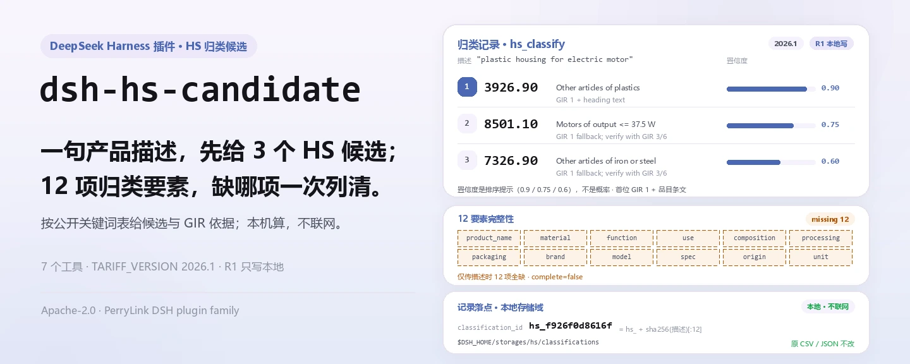
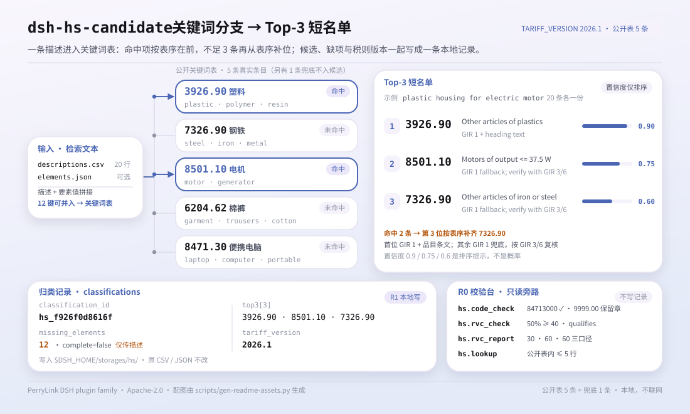
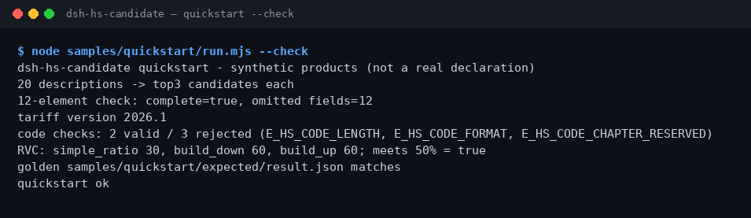

<div align="center">

<picture>
  <source media="(prefers-color-scheme: dark)" srcset="docs/assets/dsh-hs-candidate-hero-zh-dark.webp">
  
</picture>

# dsh-hs-candidate

**把产品描述变成 Top-3 HS 候选编码，并把 12 项归类要素的缺项一次列清。**

面向 DeepSeek Harness 的纯本地 HS 归类助手：按公开税则表给候选、附 GIR 依据、校验编码结构、按三种口径算 RVC；不联网、不调用模型，也不替海关做裁定。

[安装](#三步上手) · [配置](#配置) · [FAQ](#faq) · [简体中文](README.md) · [English](README.en.md) · [Español](README.es.md) · [Português](README.pt.md) · [हिन्दी](README.hi.md)

[](LICENSE)
[](#兼容性)
[](https://www.npmjs.com/package/dsh-hs-candidate)
[](https://github.com/PerryLink/dsh-hs-candidate/actions/workflows/ci.yml)
[](#兼容性)

[](https://github.com/PerryLink/dsh-hs-candidate/stargazers)
[](https://www.npmjs.com/package/dsh-hs-candidate)
[](https://dshfind.com/plugins/PerryLink/dsh-hs-candidate?ref=badge)
[](https://dsh.market/)
[](https://gitee.com/perrylink/dsh-hs-candidate)

```sh
dsh plugin --profile <profile> add dsh-hs-candidate
```

</div>

<sub>社区插件，与 DeepSeek 官方无关。唯一仓库：<https://github.com/PerryLink/dsh-hs-candidate>（Gitee 为镜像）。状态：alpha · 仅用公开/合成数据验证 · 非 GA——不含客户数据或客户证据，不作生产可用声明。</sub>

## 它是什么

HS 归类的第一公里：把一句产品描述（材质、用途、功能）变成 3 个候选 HS 编码，同时检查 12 项归类要素是否填齐。`hs.classify` 按公开关键词表给出 Top-3，附 GIR 依据与要素缺项，并把结果连同税则版本 `2026.1` 写进本地存储域；`hs.code_check` 校验编码结构，`hs.rvc_report` 按简单比值、build-down、build-up 三种口径算区域价值成分。全部计算在本机完成——不联网、不调用模型、不上传，原文件不会被修改。候选是人工复核前的线索，不是海关裁定；项目自 2026-11-01 起活跃维护，新功能、加固与证据持续更新。

- **适合**：20–500 条、有材质/用途/功能描述的产品清单；在正式归类前先拿候选编码，并检查要素是否缺项。
- **不适合**：只有品名、没有材质和用途的记录；替代海关做归类裁定；直接生成报关单（本包只给候选和结构检查）。

<picture>
  <source media="(prefers-color-scheme: dark)" srcset="docs/assets/dsh-hs-candidate-flow-v5-dark.svg">
  
</picture>

## 三步上手

1. **安装**（三选一）：

   ```sh
   # npm 通道（推荐，已发布版本）
   dsh plugin --profile <profile> add dsh-hs-candidate
   # git 通道（最新 main；等价于 git+https://github.com/PerryLink/dsh-hs-candidate.git）
   dsh plugin --profile <profile> add github:PerryLink/dsh-hs-candidate
   # tarball 通道：本仓库 pnpm pack 后
   dsh plugin --profile <profile> add ./dsh-hs-candidate-<version>.tgz
   ```

2. **最小配置**（安装命令已自动应用 bundle patch；手写 profile 时照抄这一行即可）：

   ```yaml
   - insert:
       - id: dsh-hs-candidate
         name: dsh-hs-candidate
   ```

   本插件没有 Schemastery 配置键；RVC 阈值等都在调用工具时按参数传入，见「配置」。

3. **验证已生效**：

   ```sh
   dsh --profile <profile> --dump-config | grep dsh-hs-candidate
   node samples/quickstart/run.mjs --check
   ```

   仓库自带合成样例，直接跑一次看全链路（应在结尾输出 `quickstart ok`）；也可以在会话里直接说：

   > 我有 20 条产品描述，帮我给出每条的前 3 个 HS 候选编码，再检查 12 项归类要素齐不齐。

**卸载**：`dsh plugin --profile <profile> remove dsh-hs-candidate`（或从 profile patch 删掉该行）。

<details>
<summary>从 DSH Desktop 市场安装</summary>

所有 PerryLink 插件均可在 DSH Desktop 内置市场中浏览：**市场 → 来源 → 添加来源 → 粘贴** `https://perrylink-dsh-catalog.perrylink.workers.dev/catalog-source.json` **→ 选中**。安装仍需通过市场的 npm 身份校验与你的确认。

</details>

## 核心能力

- **Top-3 候选 + GIR 依据** —— `hs.classify` 把描述与已填要素拼起来查公开关键词表，返回 3 个候选，每个带编码、描述、置信度与 `gir_basis`；首位用 GIR 1 加品目条文，其余用 GIR 1 兜底并提示按 GIR 3/6 复核。
- **12 要素完整性** —— `hs.elements` 逐项检查 `product_name`、`material`、`function`、`use`、`composition`、`processing`、`packaging`、`brand`、`model`、`spec`、`origin`、`unit`，返回缺失清单与 `complete`。
- **税则版本标记** —— 每条归类记录固定带 `TARIFF_VERSION=2026.1`；`hs.tariff_version` 返回当前版本与 12 要素清单，便于把结果和税则版本一起归档。
- **编码结构校验** —— `hs.code_check` 校验 2/4/6/8/10 位与章节 01–97，保留章 00/98/99 会拒绝并给出原因；它只验结构，不判断归类对错。
- **三口径 RVC** —— `hs.rvc_report` 用简单比值、build-down、build-up 三个公式算区域价值成分；`hs.rvc_check` 给单一口径的快速比值与阈值判定。
- **公开表查询** —— `hs.lookup` 在你提供的公开 HS 表内按编码或描述匹配，最多返回 5 行；只读，不写归类记录。
- **本地存储** —— `hs.classify` 把每条归类按描述 sha256 生成 `classification_id`，写入 `$DSH_HOME/storages/hs/` 的 `classifications` 表；原 CSV 不动。

### 工具面

工具名是稳定 API（与运行时输出一致，保持英文）；说明已本地化。写文件的工具标 **R1（本地写）**，只读工具标 **R0**。

| 工具 | 用途 | 风险 |
|---|---|---|
| `hs.elements` | 检查产品描述的 12 要素完整性，返回缺失字段 | R0 |
| `hs.classify` | 从公开表返回 Top-3 HS 候选，附 GIR 依据与要素缺项，并写入归类记录 | R1 本地写 |
| `hs.lookup` | 在传入的公开 HS 表中按编码或描述查询，最多 5 行 | R0 |
| `hs.tariff_version` | 返回当前税则版本（2026.1）与 12 要素清单 | R0 |
| `hs.rvc_check` | 计算简单的区域价值成分比例，并按阈值判定 | R0 |
| `hs.code_check` | 校验 HS 编码结构（2/4/6/8/10 位、章节 01–97） | R0 |
| `hs.rvc_report` | 按简单比值、build-down、build-up 三口径计算 RVC | R0 |

### 输入与输出

输入：

- 产品描述 CSV：UTF-8，表头 `description`；自带样例 20 行。
- 12 要素 JSON：键为 `product_name`、`material`、`function`、`use`、`composition`、`processing`、`packaging`、`brand`、`model`、`spec`、`origin`、`unit`，值为非空文本。
- 编码清单 CSV：表头 `code`，逐条交给 `hs.code_check`。
- RVC 输入 JSON：`fob_cents`、`non_originating_cents`、`domestic_value_cents`，可选 `labour_overhead_cents` 与 `threshold_pct`。
- 建议单批 ≤ 1 MB；自带样例约 1 KB。

输出：

- 终端摘要：描述条数、每条 Top-3、12 要素缺失数、税则版本、编码检查结果、RVC 三口径。
- 归类记录：`$DSH_HOME/storages/hs/`（`classifications` 表）；原文件不会被修改。
- 金标：`samples/quickstart/expected/result.json`，由真实运行产生。

### 示例

直接复制下面这句（`package.json` 里的演示提示词）：

```text
我有 20 条产品描述，帮我给出每条的前 3 个 HS 候选编码，再检查 12 项归类要素齐不齐。
```

也可以自己跑（真实运行，截图即来自这条命令）：

```sh
node samples/quickstart/run.mjs --check
```



*20 条合成描述 → 每条 Top-3 候选 → 12 要素检查 → 税则版本 2026.1 → 5 条编码检查 → 3 口径 RVC；金标为 `samples/quickstart/expected/result.json`，命令与哈希见 `screenshots.json`。*

公开 fixture 验收：输入 [`fixtures/public/mit/hs-sample.json`](https://github.com/PerryLink/dsh-hs-candidate/blob/main/fixtures/public/mit/hs-sample.json)（公开 MIT 样本，6 行），重跑 `node scripts/acceptance.mjs`，明细见 `ACCEPTANCE.csv`：

```csv
req_id,metric,threshold,actual,pass,source,counted
SKU-13-A01,Top3 候选（20）,20/20,20,true,public/synthetic,false
SKU-13-A02,缺失要素提示,>=1,12,true,public/synthetic,false
SKU-13-A03,必填要素,12,12,true,public/synthetic,false
SKU-13-A04,税则版本,set,1,true,public/synthetic,false
SKU-13-A05,RVC 简单比值,50,50,true,public/synthetic,false
SKU-13-A06,HS 编码结构,1/1,1,true,public/synthetic,false
SKU-13-A07,RVC 三口径,3,3,true,public/synthetic,false
PS1-QS01,quickstart 样例与金标一致,1/1,1,true,synthetic/quickstart,true
```

*SKU 行是公开/合成 fixture 检查（`counted=false`）；PS1-QS01 是随包样例的本地复现（`counted=true`）。均非客户运行，没有虚构输出；完整列（含 `script` 与 `evidence_sha256`）见 [`ACCEPTANCE.csv`](ACCEPTANCE.csv)。*

## 配置

本插件没有 Schemastery `Config` 配置键——`cordis.patch.yml` 只 `insert` 一行（见「三步上手」）；归类记录写到 `$DSH_HOME/storages/hs/`。可调项都在调用工具时按参数传入：

| 参数 | 默认值 | 含义 |
|---|---|---|
| `threshold_pct`（`hs.rvc_check`） | `40` | RVC 阈值（百分比）；`rvc_pct >= threshold_pct` 即 `qualifies: true` |
| `threshold_pct`（`hs.rvc_report`） | 无 | 可选；不传时只要算出三口径数值，`meets_threshold` 恒为 `true` |
| `labour_overhead_cents`（`hs.rvc_report`） | `0` | 计入 build-up 口径的工费与制造费用 |
| `elements`（`hs.elements` / `hs.classify`） | 无 | 12 要素对象；未提供或值为空的键都算缺失，因此只传描述时 12 项全缺 |
| `hs_table`（`hs.lookup`） | 无 | 你传入的公开表行；查询只在这份表内匹配，最多返回 5 行 |

## FAQ

<details>
<summary>装不上怎么办？</summary>

确认 DSH `>=0.2.1-rc.3 <0.4.0`、Node `>=24.9 <25`（见「兼容性」），再用 `dsh plugin --profile <profile> add dsh-hs-candidate` 重试；仍失败请附包版本、最小合成输入与完整报错提 issue。

</details>

<details>
<summary>候选编码看着不对怎么办？</summary>

先跑 `node samples/quickstart/run.mjs --check` 确认链路正常，再检查描述里是否写了材质、用途和功能。候选只按内置公开关键词表排序，不是海关裁定；最终编码要人工复核，结构化问题可以先用 `hs.code_check` 排除位数或字符错误。

</details>

<details>
<summary>数据存在哪？会改我的产品表吗？</summary>

不会改原文件。归类记录只写本地存储域 `$DSH_HOME/storages/hs/`（`classifications` 表）；输入 CSV / JSON 由会话读取后作为参数传给工具，不上传、不联网。

</details>

<details>
<summary>能处理我的真实报关数据吗？</summary>

可以本地运行，但本包是 alpha、只用公开/合成数据验证，不构成归类或报关结论；使用真实数据前请脱敏，并保留复核人。真实报关单不要贴进 issue。

</details>

<details>
<summary>会联网或调用模型吗？</summary>

不会。工具、样例和验收都在本机完成；源码中没有 HTTP / DNS / WebSocket 调用。

</details>

## 安全边界

- **不联网、不调用模型。** 除非工具明确说明，否则没有模型或网络调用；输入和输出都留在本地。
- **原文件不被修改。** 写操作只落在 `$DSH_HOME/storages/hs/`（`classifications` 表）；输入 CSV / JSON 只读。
- **只做候选与结构检查，不做裁定。** `hs.classify` 只查公开关键词表并给 GIR 依据，`hs.code_check` 只验位数与章节范围；最终编码必须人工复核。
- **错误格式统一、失败响亮。** 报错统一为 `<一句人话>（E_XXX）｜下一步：<动作>`；三类常见错误（描述为空 `E_HS_DESCRIPTION_MISSING`、编码位数或字符不对、编码落在保留章）的症状 / 原因 / 动作见 [TROUBLESHOOTING.md](TROUBLESHOOTING.md)。
- **风险分级。** 写文件的 `hs.classify` 标 R1（本地写），其余工具标 R0（只读）；逐工具见「核心能力」工具表。

## 权限与数据

- **读**：你指定的产品描述 CSV、12 要素 JSON、编码清单 CSV、RVC 输入 JSON；不读其他目录。
- **写**：`$DSH_HOME/storages/hs/`（归类记录）；不改原文件。
- **联网**：否（源码中没有 HTTP / DNS / WebSocket 调用）。
- **外部系统**：无（不连接海关、ERP 或税则服务）。
- **数据边界**：仅公开/合成样例验证；不含客户数据或客户证据。

## 已知限制

- **仅公开/合成数据验证。** 所有验收行都来自公开或合成 fixture（`ACCEPTANCE.csv` 中 SKU 行 `counted=false`，PS1-QS01 为样例本地复现 `counted=true`）；不含客户数据或客户证据。
- **alpha / partial / not counted / 非 GA。** 不作生产可用声明，不构成归类或报关结论。
- **候选来自小型公开关键词表。** 内置表只有 5 个真实条目（塑料、钢铁、电机、棉制裤、便携电脑），不足 3 个命中时按固定顺序补齐；置信度只是排序提示（0.9 / 0.75 / 0.6），不是概率。
- **税则版本固定 2026.1。** 工具不下载、不热更新税则；版本变化时需要升级插件。
- **编码结构不等于归类正确。** `hs.code_check` 只验 2/4/6/8/10 位与章节 01–97，保留章 00/98/99 直接拒绝；它会告诉你编码长得对不对，不会告诉你该不该归这里。
- **输入格式约束。** CSV 为 UTF-8、表头逐字匹配；建议单批 ≤ 1 MB。
- **每个工具的精确边界**见「核心能力」的工具表与 `ACCEPTANCE.csv`。

## 兼容性

| 维度 | 状态 |
|---|---|
| Harness | DeepSeek Harness `>=0.2.1-rc.3 <0.4.0`（`package.json` 的 `engines.dsh`） |
| Node | `>=24.9.0 <25`（`.nvmrc`：24） |
| 平台 | 任何 DSH 可运行处；仅本地文件 |
| 数据 | 不联网、不调用模型、不上传 |

## 生态与质量

- [Gitee 镜像](https://gitee.com/perrylink/dsh-hs-candidate)（同步镜像，以 GitHub 为准）
- [dshfind 插件页](https://dshfind.com/plugins/PerryLink/dsh-hs-candidate)（安装量与排名）
- [DSH Market](https://dsh.market/)（已上架）
- **1024 商店渠道**：先 `npm i -g dsh1024`，再 `dsh1024 plugin --profile <profile> add dsh-hs-candidate`（计入 [deepseek1024.com](https://deepseek1024.com) 安装排行）
- 文档：[`TROUBLESHOOTING.md`](TROUBLESHOOTING.md)（故障排查）· [`PRIVACY.md`](PRIVACY.md) · [`SECURITY.md`](SECURITY.md) · [`EVIDENCE.md`](EVIDENCE.md) · [领域索引](https://perrylink.github.io/dsh-plugins/) · [Checker 家族](https://perrylink.github.io/zh/checkers/) · [主线家族](https://github.com/PerryLink/dsh-kit)

### 相关项目与核查器

兄弟包与家族索引：[dsh-freight-audit](https://github.com/PerryLink/dsh-freight-audit) · [dsh-pim-lint](https://github.com/PerryLink/dsh-pim-lint)

每个核查器都是独立包、各有自己的规则包与版本，按需安装：

| 包 | 为何相关 |
|---|---|
| [`dsh-hs-classify`](https://github.com/PerryLink/dsh-hs-classify) | 对已申报的归类做 HS 层级一致性检查 |
| [`dsh-origin-rvc-check`](https://github.com/PerryLink/dsh-origin-rvc-check) | 区域价值成分与原产地判定 |
| [`dsh-customs-doc-check`](https://github.com/PerryLink/dsh-customs-doc-check) | 报关单证一致性检查 |

## 开发

```sh
pnpm install --frozen-lockfile                              # node >=24.9 <25
pnpm build && pnpm lint && pnpm typecheck && pnpm test      # tsc 构建 + lint + 13 个 node --test 用例
pnpm gate:sku13                                             # SKU-13 验收门禁（ACCEPTANCE.csv）
node scripts/acceptance.mjs                                 # 重跑公开/合成验收
node samples/quickstart/run.mjs --check                     # 合成样例对照金标，应输出 quickstart ok
pnpm run pack:check                                         # 发布内容 dry-run 校验（生成 pack.json）
```

当前版本 `0.1.1`（与 `package.json` 一致）。测试：`node --test test/*.test.mjs` 全绿（7 个测试文件、13 个用例；`pnpm test` 已内置构建步骤）。TypeScript 源码在 `src/`（`src/core/` 归类、编码与 RVC 逻辑，`src/plugin/` 宿主面与存储域），构建产物在 `lib/`；fixture 在 `fixtures/public/mit/`，随包样例在 `samples/quickstart/`，验收记录在 `evidence/`。开头 hero 与结构图由 [`scripts/gen-readme-assets.py`](scripts/gen-readme-assets.py) 程序化生成（Pillow 出 zh/en × 深浅四版 hero，手写 SVG 出深浅双版结构图），可重复执行：`python scripts/gen-readme-assets.py`。

Topics：`deepseek-harness`, `dsh`, `dsh-plugin`, `hs`, `customs`, `tariff`, `perrylink`, `trade`

## 家族与致谢

本项目是 [PerryLink](https://github.com/PerryLink) 维护的 DeepSeek Harness 插件家族成员（全部 Apache-2.0）。如果这个插件帮到了你，**给个 star**——它不解锁任何功能，但会让下一个人更容易找到它。

- [@PerryLink](https://github.com/PerryLink) —— 创建者与维护者：HS 候选引擎、12 要素检查、编码结构校验、三口径 RVC、quickstart 样例与验收套件、五语文档。

## License

[LICENSE](LICENSE)（Apache License 2.0）© 2026 dsh-hs-candidate contributors；另见 `NOTICE` 与 `THIRD-PARTY-NOTICES`。

<p align="center"><sub>Apache-2.0 · 社区插件，与 DeepSeek 无关。</sub></p>
