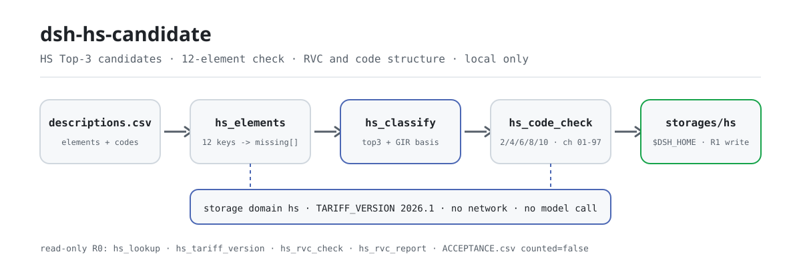
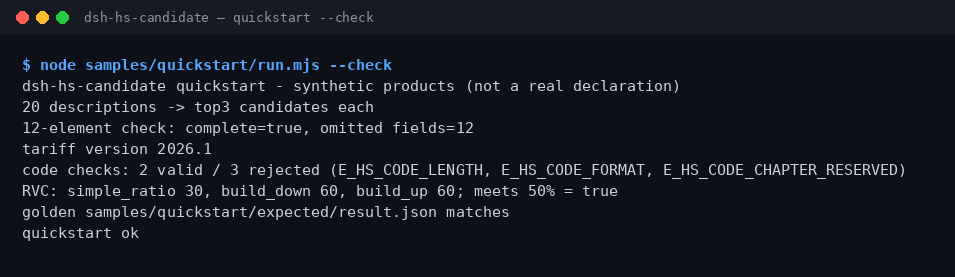

<div align="center">

<picture>
  <source media="(prefers-color-scheme: dark)" srcset="docs/assets/dsh-hs-candidate-flow-dark.svg">
  
</picture>

# dsh-hs-candidate

**Transforme uma descrição de produto nos 3 candidatos HS principais e liste de uma vez todos os elementos de classificação que faltam dos 12.**

Um assistente de classificação HS puramente local para o DeepSeek Harness: candidatos de tabela pública com base GIR, validação da estrutura de códigos e RVC com três fórmulas; sem rede, sem chamada a modelo e sem se arrogar uma decisão aduaneira.

[Instalação](#instalação-em-três-passos) · [Configuração](#configuração) · [FAQ](#faq) · [简体中文](README.md) · [English](README.en.md) · [Español](README.es.md) · [Português](README.pt.md) · [हिन्दी](README.hi.md)

[](LICENSE)
[](#compatibilidade)
[](https://www.npmjs.com/package/dsh-hs-candidate)
[](https://github.com/PerryLink/dsh-hs-candidate/actions/workflows/ci.yml)
[](#compatibilidade)

[](https://github.com/PerryLink/dsh-hs-candidate/stargazers)
[](https://www.npmjs.com/package/dsh-hs-candidate)
[](https://dshfind.com/plugins/PerryLink/dsh-hs-candidate?ref=badge)
[](https://dsh.market/)
[](https://gitee.com/perrylink/dsh-hs-candidate)

```sh
dsh plugin --profile <profile> add dsh-hs-candidate
```

</div>

<sub>Plugin da comunidade, sem afiliação com a DeepSeek. Repositório canônico: <https://github.com/PerryLink/dsh-hs-candidate> (o Gitee é um espelho). Status: alpha · apenas validação pública/sintética · não GA: sem dados ou evidência de clientes, sem promessa de produção.</sub>

## O que é

O primeiro trecho da classificação HS: transforma uma descrição de produto (material, uso, função) em 3 códigos HS candidatos e, ao mesmo tempo, verifica se os 12 elementos de classificação estão completos. `hs.classify` devolve o Top-3 a partir de uma tabela pública de palavras-chave com base GIR e os elementos faltantes, e grava o resultado com a versão tarifária `2026.1` no domínio de armazenamento local; `hs.code_check` valida a estrutura do código e `hs.rvc_report` calcula o conteúdo regional pelas fórmulas de razão simples, build-down e build-up. Tudo roda na sua máquina: sem rede, sem chamada a modelo, sem upload, e os arquivos de entrada nunca são modificados. Os candidatos são pistas para revisão humana, não uma decisão aduaneira; o projeto é mantido ativamente desde 2026-11-01, com novos recursos, endurecimento e evidência contínua.

- **Serve para**: listas de 20–500 produtos com material, uso e função descritos; obter códigos candidatos e uma checagem de elementos antes da classificação formal.
- **Não serve para**: linhas só com o nome, sem material nem uso; substituir uma decisão aduaneira; gerar uma declaração de importação (este pacote só dá candidatos e checagens estruturais).

## Instalação em três passos

1. **Instale** (escolha um canal):

   ```sh
   # canal npm (recomendado, versões publicadas)
   dsh plugin --profile <profile> add dsh-hs-candidate
   # canal git (último main; equivale a git+https://github.com/PerryLink/dsh-hs-candidate.git)
   dsh plugin --profile <profile> add github:PerryLink/dsh-hs-candidate
   # canal tarball: pnpm pack neste repo e depois
   dsh plugin --profile <profile> add ./dsh-hs-candidate-<version>.tgz
   ```

2. **Configuração mínima** (o comando de instalação já aplica o patch do bundle; copie esta linha se escrever o perfil à mão):

   ```yaml
   - insert:
       - id: dsh-hs-candidate
         name: dsh-hs-candidate
   ```

   Não há chaves de configuração do Schemastery; os limites de RVC e afins são passados em cada chamada de ferramenta — ver «Configuração».

3. **Verifique se monta**:

   ```sh
   dsh --profile <profile> --dump-config | grep dsh-hs-candidate
   node samples/quickstart/run.mjs --check
   ```

   O repo inclui uma amostra sintética; rode uma vez para ver a cadeia inteira (deve terminar com `quickstart ok`). Numa sessão você também pode dizer:

   > Tenho 20 descrições de produtos; me dê os 3 códigos HS candidatos de cada uma e verifique se os 12 elementos de classificação estão completos.

**Desinstalar**: `dsh plugin --profile <profile> remove dsh-hs-candidate` (ou remova a linha do patch do perfil).

<details>
<summary>Instalar pelo mercado do DSH Desktop</summary>

Todos os plugins PerryLink aparecem no mercado embutido do DSH Desktop: **Mercado → Fontes → Adicionar fonte → colar** `https://perrylink-dsh-catalog.perrylink.workers.dev/catalog-source.json` **→ selecionar**. A instalação ainda exige a checagem de identidade npm do mercado e a sua confirmação.

</details>

## Recursos principais

- **Candidatos Top-3 com base GIR** — `hs.classify` junta a descrição aos elementos disponíveis, consulta a tabela pública de palavras-chave e devolve 3 candidatos, cada um com código, descrição, confiança e `gir_basis`; o primeiro usa GIR 1 mais o texto da posição, e os demais caem em GIR 1 e pedem verificação com GIR 3/6.
- **Completude dos 12 elementos** — `hs.elements` verifica `product_name`, `material`, `function`, `use`, `composition`, `processing`, `packaging`, `brand`, `model`, `spec`, `origin` e `unit`, devolvendo a lista de faltantes mais `complete`.
- **Selo de versão tarifária** — cada registro de classificação leva `TARIFF_VERSION=2026.1`; `hs.tariff_version` devolve a versão ativa e a lista de 12 elementos para arquivar o resultado junto da versão.
- **Checagem da estrutura do código** — `hs.code_check` valida 2/4/6/8/10 dígitos e os capítulos 01–97; capítulos reservados 00/98/99 são rejeitados com motivo. Verifica só a estrutura, nunca se a classificação está certa.
- **Três fórmulas de RVC** — `hs.rvc_report` calcula o conteúdo regional por razão simples, build-down e build-up; `hs.rvc_check` dá o número rápido de uma só razão com veredicto de limite.
- **Consulta em tabela pública** — `hs.lookup` busca por código ou descrição dentro de uma tabela HS pública fornecida por você, devolvendo no máximo 5 linhas; é somente leitura e não grava registros.
- **Armazenamento local** — `hs.classify` deriva um `classification_id` do sha256 da descrição e grava cada registro na tabela `classifications` em `$DSH_HOME/storages/hs/`; o CSV original não é tocado.

### Superfície de ferramentas

Os nomes de ferramenta são a API estável (mantidos em inglês para coincidir com a saída do runtime); as descrições estão localizadas. Ferramentas que gravam arquivos são **R1 (gravação local)**; as somente leitura são **R0**.

| Ferramenta | Propósito | Risco |
|---|---|---|
| `hs.elements` | Verifica a completude dos 12 elementos de uma descrição e devolve os campos faltantes | R0 |
| `hs.classify` | Devolve o Top-3 de candidatos HS de uma tabela pública com base GIR e lacunas de elementos, e grava a classificação | R1 gravação local |
| `hs.lookup` | Busca linhas por código ou descrição numa tabela HS pública fornecida, no máximo 5 | R0 |
| `hs.tariff_version` | Devolve a versão tarifária ativa (2026.1) e a lista de 12 elementos | R0 |
| `hs.rvc_check` | Calcula uma razão simples de conteúdo regional com veredicto de limite | R0 |
| `hs.code_check` | Valida a estrutura do código HS (2/4/6/8/10 dígitos, capítulos 01–97) | R0 |
| `hs.rvc_report` | Calcula o RVC pelas fórmulas de razão simples, build-down e build-up | R0 |

### Entrada e saída

Entrada:

- CSV de descrições: UTF-8, cabeçalho `description`; a amostra incluída tem 20 linhas.
- JSON de 12 elementos: chaves `product_name`, `material`, `function`, `use`, `composition`, `processing`, `packaging`, `brand`, `model`, `spec`, `origin`, `unit`, com texto não vazio.
- CSV de códigos: cabeçalho `code`, cada linha vai para `hs.code_check`.
- JSON de entrada RVC: `fob_cents`, `non_originating_cents`, `domestic_value_cents`, e opcionais `labour_overhead_cents` e `threshold_pct`.
- Mantenha o lote ≤ 1 MB; a amostra incluída tem cerca de 1 KB.

Saída:

- Resumo no terminal: número de linhas, Top-3 por linha, elementos faltantes, versão tarifária, resultados dos códigos e as três fórmulas de RVC.
- Registros de classificação: `$DSH_HOME/storages/hs/` (tabela `classifications`); os arquivos originais não são modificados.
- Arquivo dourado: `samples/quickstart/expected/result.json`, produzido por uma execução real.

### Exemplos

Copie este prompt tal e qual (o prompt de demonstração do `package.json`):

```text
我有 20 条产品描述，帮我给出每条的前 3 个 HS 候选编码，再检查 12 项归类要素齐不齐。
```

Ou rode você mesmo (execução real; a captura vem deste comando):

```sh
node samples/quickstart/run.mjs --check
```



*20 descrições sintéticas → Top-3 por descrição → checagem dos 12 elementos → versão tarifária 2026.1 → 5 checagens de código → RVC com 3 fórmulas; o arquivo dourado é `samples/quickstart/expected/result.json`, comando e hashes em `screenshots.json`.*

Aceitação com fixture público: entrada [`fixtures/public/mit/hs-sample.json`](https://github.com/PerryLink/dsh-hs-candidate/blob/main/fixtures/public/mit/hs-sample.json) (amostra pública MIT, 6 linhas); rode de novo `node scripts/acceptance.mjs`, detalhes em `ACCEPTANCE.csv`:

```csv
req_id,metric,threshold,actual,pass,source,counted
SKU-13-A01,Top3 候选（20）,20/20,20,true,public/synthetic,false
SKU-13-A02,缺失要素提示,>=1,12,true,public/synthetic,false
SKU-13-A03,必填要素,12,12,true,public/synthetic,false
SKU-13-A04,税则版本,set,1,true,public/synthetic,false
SKU-13-A05,RVC 简单比值,50,50,true,public/synthetic,false
SKU-13-A06,HS 编码结构,1/1,1,true,public/synthetic,false
SKU-13-A07,RVC 三口径,3,3,true,public/synthetic,false
PS1-QS01,quickstart 样例与金标一致,1/1,1,true,synthetic/quickstart,true
```

*As linhas SKU são checagens com fixture público/sintético (`counted=false`); PS1-QS01 é a repetição da amostra incluída (`counted=true`). Nenhuma é execução de cliente e nenhuma saída é inventada; as colunas completas (incl. `script` e `evidence_sha256`) estão em [`ACCEPTANCE.csv`](ACCEPTANCE.csv).*

## Configuração

Este plugin não tem chaves `Config` do Schemastery: o `cordis.patch.yml` apenas `insert`a uma linha (ver «Instalação em três passos») e os registros de classificação vão para `$DSH_HOME/storages/hs/`. Tudo o que é ajustável é parâmetro por chamada:

| Parâmetro | Padrão | Significado |
|---|---|---|
| `threshold_pct` (`hs.rvc_check`) | `40` | Limite de RVC em porcentagem; `rvc_pct >= threshold_pct` resulta em `qualifies: true` |
| `threshold_pct` (`hs.rvc_report`) | nenhum | Opcional; se omitido, as três fórmulas são informadas e `meets_threshold` é sempre `true` |
| `labour_overhead_cents` (`hs.rvc_report`) | `0` | Mão de obra e custos indiretos contados na fórmula build-up |
| `elements` (`hs.elements` / `hs.classify`) | nenhum | Objeto de 12 elementos; chaves ausentes ou vazias contam como faltantes, então só com a descrição faltam as 12 |
| `hs_table` (`hs.lookup`) | nenhum | As linhas de tabela pública que você fornece; a consulta só busca nessa tabela, no máximo 5 linhas |

## FAQ

<details>
<summary>Não instala — e agora?</summary>

Confirme que o DSH é `>=0.2.1-rc.3 <0.4.0` e o Node `>=24.9 <25` (ver «Compatibilidade») e tente de novo `dsh plugin --profile <profile> add dsh-hs-candidate`; se ainda falhar, abra uma issue com a versão do pacote, uma entrada sintética mínima e o erro completo.

</details>

<details>
<summary>Os códigos candidatos parecem errados — o que revisar?</summary>

Primeiro rode `node samples/quickstart/run.mjs --check` para confirmar que a cadeia funciona e depois veja se a descrição informa material, uso e função. Os candidatos são ordenados por uma tabela pública de palavras-chave, não por uma decisão aduaneira; o código final precisa de revisão humana, e erros estruturais podem ser descartados antes com `hs.code_check`.

</details>

<details>
<summary>Onde os dados ficam? Minha tabela de produtos é alterada?</summary>

Nenhum arquivo de entrada é modificado. Os registros de classificação são gravados apenas no domínio de armazenamento local `$DSH_HOME/storages/hs/` (tabela `classifications`); a sessão lê o CSV/JSON de entrada e o passa às ferramentas como parâmetro, sem upload e sem rede.

</details>

<details>
<summary>Posso usar dados reais de importação?</summary>

Roda localmente, mas este pacote é alpha e validado apenas com dados públicos/sintéticos, então não constitui conclusão de classificação nem de importação; anonimize os dados reais e mantenha um revisor. Não cole declarações reais em issues.

</details>

<details>
<summary>Chama a rede ou um modelo?</summary>

Não. Ferramentas, amostras e aceitação rodam localmente; o código-fonte não tem chamadas HTTP / DNS / WebSocket.

</details>

## Limites de segurança

- **Sem rede e sem chamada a modelo.** A menos que uma ferramenta diga o contrário, não há chamada a modelo nem à rede; entrada e saída ficam locais.
- **Arquivos originais não são modificados.** As gravações vão apenas para `$DSH_HOME/storages/hs/` (tabela `classifications`); o CSV/JSON de entrada é somente leitura.
- **Só candidatos e checagens estruturais, nunca uma decisão.** `hs.classify` só consulta a tabela pública de palavras-chave e dá uma base GIR; `hs.code_check` só valida quantidade de dígitos e faixa de capítulos. O código final sempre exige revisão humana.
- **Erros uniformes e barulhentos.** Cada erro é uma frase simples mais o código `E_XXX` mais uma próxima ação; os sintomas / causas / ações dos três comuns (descrição vazia `E_HS_DESCRIPTION_MISSING`, tamanho ou caracteres do código errados, capítulo reservado) estão em [TROUBLESHOOTING.md](TROUBLESHOOTING.md).
- **Graduação de risco.** `hs.classify` grava arquivos e é R1 (gravação local); os demais são R0 (somente leitura) — ver a tabela de ferramentas em «Recursos principais».

## Permissões e dados

- **Leitura**: o CSV de descrições, o JSON de 12 elementos, o CSV de códigos e o JSON de RVC que você indicar; nenhum outro diretório.
- **Gravação**: `$DSH_HOME/storages/hs/` (registros de classificação); os arquivos originais não são tocados.
- **Rede**: não (sem chamadas HTTP / DNS / WebSocket no código).
- **Sistemas externos**: nenhum (não contata alfândega, ERP nem serviço tarifário).
- **Limite de dados**: apenas amostras públicas/sintéticas; sem dados ou evidência de clientes.

## Limitações conhecidas

- **Apenas validação pública/sintética.** Todas as linhas de aceitação vêm de fixture público ou sintético (`counted=false` nas linhas SKU, `counted=true` na repetição PS1-QS01); sem dados ou evidência de clientes.
- **alpha / parcial / não contabilizado / não GA.** Sem promessa de produção; não é conclusão de classificação nem de importação.
- **Os candidatos vêm de uma tabela pública pequena.** Tem só 5 entradas reais (plásticos, ferro/aço, motores, calças de algodão, computadores portáteis) e, quando menos de 3 coincidem, a lista é completada em ordem fixa; a confiança é só uma pista de ordenação (0.9 / 0.75 / 0.6), não uma probabilidade.
- **A versão tarifária é fixa em 2026.1.** As ferramentas não baixam nem atualizam tabelas tarifárias a quente; atualize o plugin quando a versão mudar.
- **Estrutura válida não é classificação correta.** `hs.code_check` só valida 2/4/6/8/10 dígitos e os capítulos 01–97, rejeitando os reservados 00/98/99; ele diz se o código tem forma correta, não se pertence ali.
- **Restrições de formato de entrada.** CSV em UTF-8 com cabeçalho exato; mantenha o lote ≤ 1 MB.
- **Os limites exatos de cada ferramenta** estão na tabela de «Recursos principais» e no `ACCEPTANCE.csv`.

## Compatibilidade

| Dimensão | Estado |
|---|---|
| Harness | DeepSeek Harness `>=0.2.1-rc.3 <0.4.0` (`engines.dsh` no `package.json`) |
| Node | `>=24.9.0 <25` (`.nvmrc`: 24) |
| Plataforma | Onde o DSH rodar; apenas arquivos locais |
| Dados | Sem rede, sem chamada a modelo, sem upload |

## Ecossistema e qualidade

- [Espelho no Gitee](https://gitee.com/perrylink/dsh-hs-candidate) (espelho sincronizado; o GitHub é o canônico)
- [Página no dshfind](https://dshfind.com/plugins/PerryLink/dsh-hs-candidate) (instalações e ranking)
- [DSH Market](https://dsh.market/) (publicado)
- **Canal da loja 1024**: rode `npm i -g dsh1024` e depois `dsh1024 plugin --profile <profile> add dsh-hs-candidate` (conta para o ranking de instalações do [deepseek1024.com](https://deepseek1024.com))
- Documentação: [`TROUBLESHOOTING.md`](TROUBLESHOOTING.md) (solução de problemas) · [`PRIVACY.md`](PRIVACY.md) · [`SECURITY.md`](SECURITY.md) · [`EVIDENCE.md`](EVIDENCE.md) · [índice de domínio](https://perrylink.github.io/dsh-plugins/) · [família Checker](https://perrylink.github.io/zh/checkers/) · [família principal](https://github.com/PerryLink/dsh-kit)

### Projetos e verificadores relacionados

Pacotes irmãos e índices de família: [dsh-freight-audit](https://github.com/PerryLink/dsh-freight-audit) · [dsh-pim-lint](https://github.com/PerryLink/dsh-pim-lint)

Cada verificador é um pacote separado, com seu próprio pacote de regras e versão; instale só os que precisar:

| Pacote | Por que é relevante |
|---|---|
| [`dsh-hs-classify`](https://github.com/PerryLink/dsh-hs-classify) | Consistência hierárquica HS para uma classificação declarada |
| [`dsh-origin-rvc-check`](https://github.com/PerryLink/dsh-origin-rvc-check) | Conteúdo regional e determinação de origem |
| [`dsh-customs-doc-check`](https://github.com/PerryLink/dsh-customs-doc-check) | Consistência de documentos de declaração aduaneira |

## Desenvolvimento

```sh
pnpm install --frozen-lockfile                              # node >=24.9 <25
pnpm build && pnpm lint && pnpm typecheck && pnpm test      # build tsc + lint + 13 casos node --test
pnpm gate:sku13                                             # portão de aceitação SKU-13 (ACCEPTANCE.csv)
node scripts/acceptance.mjs                                 # repetir a aceitação pública/sintética
node samples/quickstart/run.mjs --check                     # amostra contra o arquivo dourado; deve imprimir quickstart ok
pnpm run pack:check                                         # dry-run do conteúdo publicado (grava pack.json)
```

Versão atual `0.1.1` (igual ao `package.json`). Testes: `node --test test/*.test.mjs` verde (7 arquivos de teste, 13 casos; `pnpm test` já inclui o build). O código TypeScript está em `src/` (`src/core/` tem a lógica de classificação, códigos e RVC; `src/plugin/` a face host e o domínio de armazenamento), a saída de build em `lib/`; os fixtures em `fixtures/public/mit/`, a amostra incluída em `samples/quickstart/` e os registros de aceitação em `evidence/`. O diagrama de abertura é gerado por [`scripts/gen-readme-assets.py`](scripts/gen-readme-assets.py) (Python; par SVG claro/escuro compartilhado pelos cinco idiomas) e pode ser repetido com `python scripts/gen-readme-assets.py`.

Tópicos: `deepseek-harness`, `dsh`, `dsh-plugin`, `hs`, `customs`, `tariff`, `perrylink`, `trade`

## Família e agradecimentos

Este projeto é membro da família de plugins do DeepSeek Harness mantida pela [PerryLink](https://github.com/PerryLink) (todos Apache-2.0). Se este plugin ajudar você, **deixe uma estrela** — ela não desbloqueia nada, mas faz a próxima pessoa encontrá-lo mais facilmente.

- [@PerryLink](https://github.com/PerryLink) — criador e mantenedor: motor de candidatos HS, checagem dos 12 elementos, validação de estrutura de códigos, RVC de três fórmulas, amostra quickstart e suíte de aceitação, e documentação em cinco idiomas.

## Licença

[LICENSE](LICENSE) (Apache License 2.0) © 2026 dsh-hs-candidate contributors; veja também `NOTICE` e `THIRD-PARTY-NOTICES`.

<p align="center"><sub>Apache-2.0 · Plugin da comunidade, sem afiliação com a DeepSeek.</sub></p>
